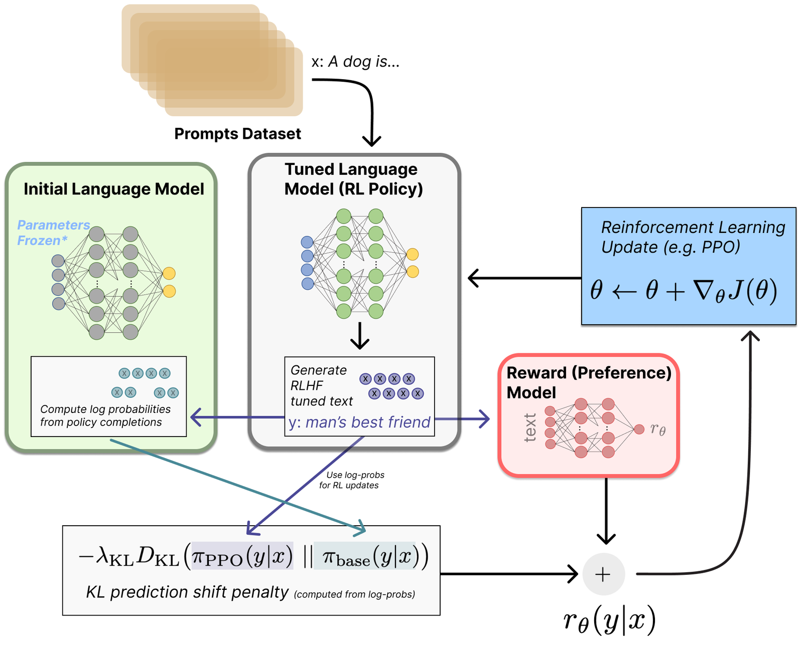
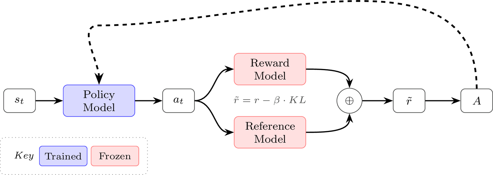
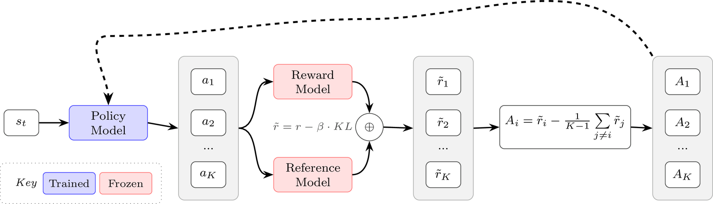
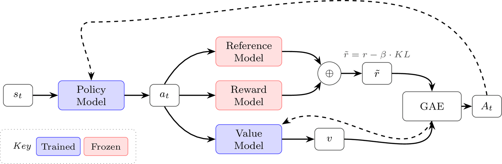
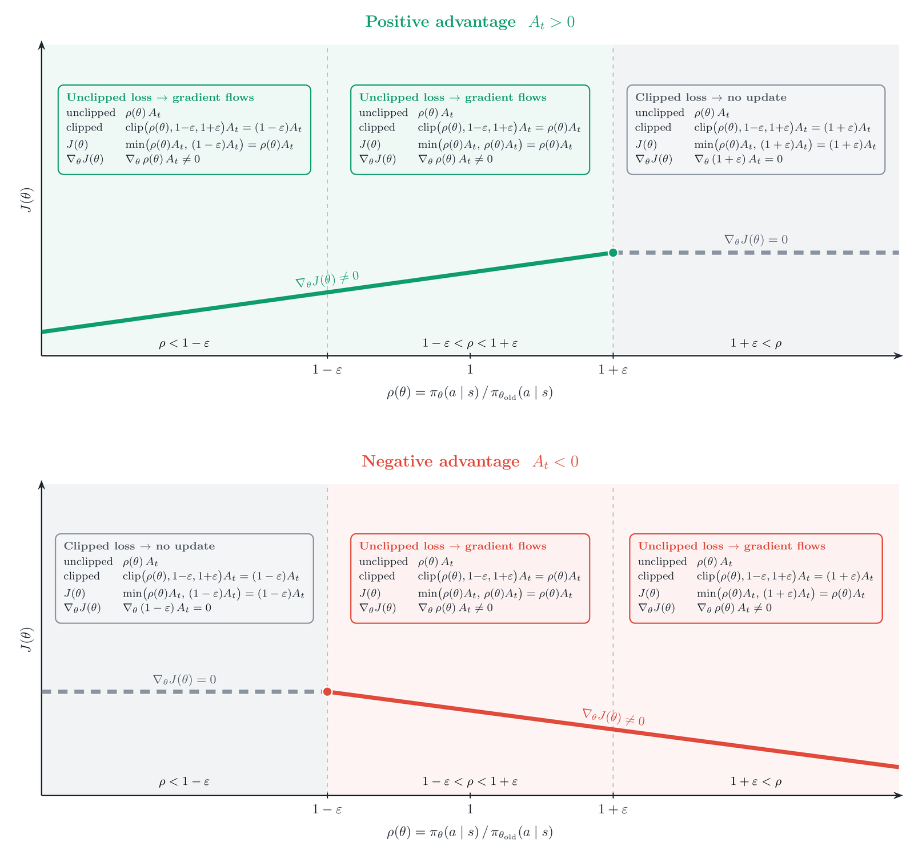
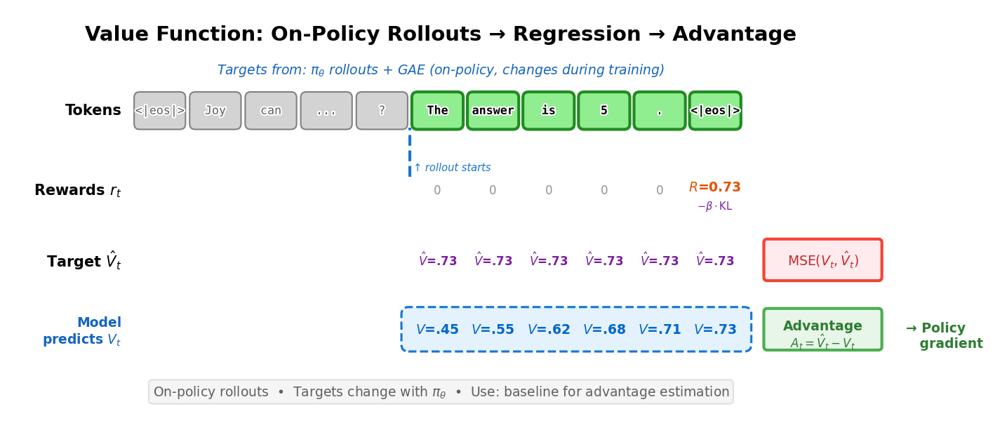
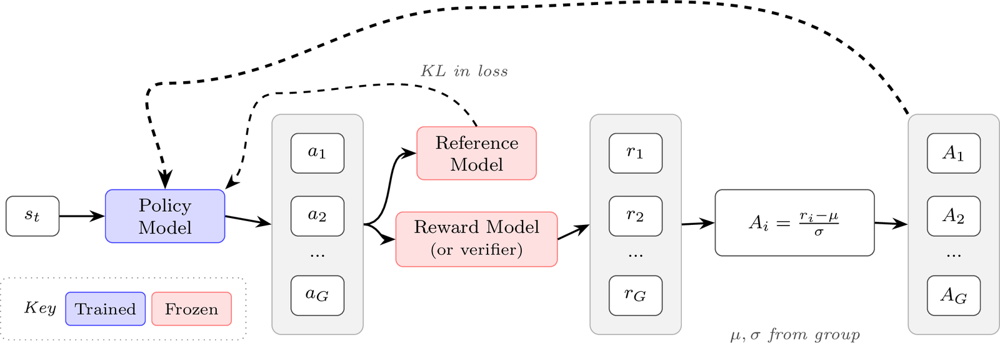

# 第 6 章　强化学习（Reinforcement Learning）

> 译自 Nathan Lambert, *Reinforcement Learning from Human Feedback*（rlhfbook.com），2026-07-01 版，原文第 53–93 页。本档为前半（6.1–6.2）。

在 RLHF 流程中，强化学习算法会根据奖励模型（reward model）的反馈，缓慢地更新模型的权重。策略（policy）——也就是正在被训练的模型——会针对训练集中的提示词（prompt）生成补全（completion），接着由奖励模型为其评分，然后强化学习优化器再依据这些信息执行梯度更新（整体概览见图 16）。本章将说明各种算法的数学原理与取舍，这些算法用来从奖励模型对 on-policy 数据所给出的信号中学习。这些算法会执行许多个 epoch，通常是在较大的提示词集合上跑过数千甚至数百万个批次（batch），并在每个批次之间进行梯度更新。

## 6.1 强化学习在 RLHF 中的角色

让 RLHF 在语言模型上声名大噪的算法，正是策略梯度（policy gradient）类的强化学习算法。这些算法——例如近端策略优化（Proximal Policy Optimization, PPO）、群组相对策略优化（Group Relative Policy Optimization, GRPO）与 REINFORCE——使用最近生成的样本来更新模型（而不是像 Deep Q-Networks（DQN）那类算法把分数存进重播缓冲区（replay buffer），DQN 曾被用于 AlphaGo 等知名项目）。在本节中，我们将介绍策略梯度算法的基础，以及它们如何被运用在现代 RLHF 框架之中。

从机器学习的层面来看，本节是整个 RLHF 流程中复杂度最高的主题。不过，正如大多数现代 AI 模型一样，决定其成败的最大因素仍然是作为流程输入的数据。

当 RLHF 随着 ChatGPT 进入大众视野时，外界大致已知他们使用的是 PPO 的某种变体，许多早期的尝试也都以此为基础。随着时间推移，多个研究项目展示了 REINFORCE 式算法的潜力 [111] [109]，其卖点是比 PPO 更简单：不需要独立的价值模型（节省内存，因此减少所需的 GPU 数量），并且采用更简单的优势估计（不需要广义优势估计（Generalized Advantage Estimation, GAE）——GAE 是一种用来计算优势的方法，用于降低策略梯度算法的方差）。后来又出现了更多算法，包括在推理任务上特别流行的群组相对策略优化（GRPO），但一般而言，这些算法多半都可以针对特定任务进行调校。在本章中，我们会介绍核心的策略梯度框架，以及上述三种算法——因为它们在建立 RLHF 经典文献体系中扮演了核心角色。

最简单的情况下，RLHF 的 RL 阶段需要两个模型：一个策略（正在被训练的模型），以及一个为其输出评分的奖励模型（如前一章所述）。RL 之前的策略副本会作为参考模型（reference model），用来计算 KL 惩罚（这个模型是冻结的，也就是说它不会被自动微分引擎的梯度更新）。本章涵盖的最复杂算法 PPO 还会加入第四个模型——一个学习而来的价值函数（value function），用来估计动作中每个 token 的好坏，它同样是一个在训练过程中被更新的大型语言模型。本章的算法之间的差异，主要在于它们如何估计一个称为「优势（advantage）」的量——衡量模型当前动作（补全）相对于平均水平有多好——以及它们如何约束策略更新，让优化过程在数值上保持稳定。这个 RLHF 流程（不含价值模型）的可视化概览如图 16 所示。

符号定义请参见问题设定（Problem Setup）章节。


*图 16：RLHF 训练循环概览。数据集中的提示词被送入微调中的策略，由其生成一个补全。奖励模型为这个补全评分，同时冻结的初始模型（通常是 RL 之前的指令微调模型）对同一段文字计算对数概率，用来计算防止过度漂移的 KL 惩罚。合并后的奖励信号接着驱动强化学习更新策略参数。*

> *本章使用强化学习文献中的 $(s, a)$ 记号，其中 $s$ 代表状态（state）、$a$ 代表动作（action）。在语言模型的情境下，你常会看到改用 $(x, y)$，其中 $x$ 是提示词、$y$ 是补全。$(s, a)$ 的框架更为一般化——这些算法原本是为「每个时间步都要采取动作」的序列决策问题所设计。然而，许多 RLHF 实现将整个补全视为单一动作，因此 $(x, y)$ 记号同样成立。*
>
> **RL 速查表（RL Cheatsheet）：** *本章所有核心 RL 损失函数的单页参考数据，可在 rlhfbook.com/rl-cheatsheet 取得。*

## 6.2 策略梯度算法（Policy Gradient Algorithms）

本章的核心，就是理解以下这种形式的方程。这个方程计算的是我们正在训练的语言模型 $\pi_\theta$ 的梯度 $\Delta\theta$：

$$
\Delta \theta \propto \Psi_t \, \nabla_\theta \log \pi_\theta(a_t \mid s_t) \tag{24}
$$

这里，方程由两个关键部分组成：1. $\nabla_\theta \log \pi_\theta(a_t \mid s_t)$——参数空间中哪个方向会让动作 $a_t$ 更有可能出现。2. $\Psi_t$——这个动作有多好？一个为结果打分的标量。

把两者放在一起，没错，将这两个量相乘，就得到了策略梯度更新。有些性质很直观，例如 $\Psi_t > 0$ 时参数更新会让 $a_t$ 更有可能出现，$\Psi_t < 0$ 时更新则会让它更不可能出现。策略梯度计算的是哪些参数对某个动作有贡献，以及我们是否应该让这个动作在未来更常或更少发生。本章接下来会深入探讨做到这件事的各种方式，以及让它在 LLM 上行得通的具体技巧。

现在，让我们把这件事再形式化一点。强化学习算法的设计目标，是最大化由状态 $s \in \mathcal{S}$ 和动作 $a \in \mathcal{A}$ 构成的轨迹（trajectory）上未来的折扣奖励（更多符号请见附录 A「定义」）。智能体（agent）的目标通常称为回报（return），是从给定时间 $t$ 开始的折扣奖励总和（其中 $\gamma \in [0,1]$ 是一个优先考虑近期奖励的因子）：

$$
G_t = r_t + \gamma r_{t+1} + \cdots = \sum_{k=0}^{\infty} \gamma^k r_{t+k}. \tag{25}
$$

回报的定义也可以写成递归形式：

$$
G_t = r_t + \gamma G_{t+1}. \tag{26}
$$

这个回报是学习价值函数 $V(s)$ 的基础——价值函数是在给定当前状态下，对未来回报的估计：

$$
V(s) = \mathbb{E}\left[G_t \mid S_t = s\right]. \tag{27}
$$

所有策略梯度算法都在优化一个策略 $\pi_\theta(a \mid s)$ 以最大化期望回报；这个目标可以用其诱导出的价值函数 $V^{\pi_\theta}(s)$ 来表达。

令 $d_0(s)$ 为初始状态分布。我们要最大化的回合式（episodic）目标可以写成：

$$
J(\theta) \;=\; \sum_s d_0(s) V^{\pi_\theta}(s), \tag{28}
$$

在有限 MDP 中，这是对所有可能起始状态的加总，但实际应用中我们从不精确计算它。取而代之的是，我们透过从当前策略采样 rollout（推演样本）来以数据估计它。在 RLHF 中，这通常意味着从数据集中采样提示词 $x_i$，并生成补全 $y_i \sim \pi_\theta(\cdot \mid x_i)$。令 $R(x_i, y_i)$ 表示指派给该提示词–补全对的标量序列层级奖励；若 $\tau_i$ 是对应的回合，这就是轨迹奖励 $R(\tau_i)$。接着我们取经验平均，例如：

$$
\hat{J}(\theta) = \frac{1}{B}\sum_{i=1}^{B} R(x_i, y_i), \tag{29}
$$

或者，在具有每步奖励的 MDP 观点下：

$$
\hat{J}(\theta) = \frac{1}{B}\sum_{i=1}^{B}\sum_{t=0}^{T_i} \gamma^t r_{i,t}. \tag{30}
$$

实际应用中，语言模型的 RLHF 会设定 $\gamma = 1$（不做折扣），因为优化的单位是整体的补全，而非个别 token——这个选择会在本章稍后的「MDP 与 Bandit」一节进一步讨论。

策略梯度算法的核心，是计算相对于当前策略的有限时间期望回报的梯度。有了这个期望回报 $J$，参数更新可以如下计算，其中 $\alpha$ 是学习率：

$$
\theta \leftarrow \theta + \alpha \nabla_\theta J(\theta) \tag{31}
$$

核心的实现细节就在于如何计算这个梯度。

### 6.2.1 推导策略梯度

令 $p_\theta(\tau)$ 表示由初始状态分布 $d_0$、策略 $\pi_\theta$ 以及环境转移动态所诱导出的轨迹分布（在下方式 34 中展开）。RL 目标的另一种写法如下：

$$
J(\theta) = \mathbb{E}_{\tau \sim p_\theta}\left[R(\tau)\right], \tag{32}
$$

其中 $\tau = (s_0, a_0, s_1, a_1, \ldots)$ 是一条轨迹，而 $R(\tau) = \sum_{t=0}^{\infty} r_t$ 是该轨迹的总奖励。或者，我们也可以把期望值写成对所有可能轨迹的积分：

$$
J(\theta) = \int_\tau p_\theta(\tau) R(\tau) d\tau \tag{33}
$$

注意到轨迹概率可以表示如下，其中 $\pi_\theta(a_t|s_t)p(s_{t+1}|s_t, a_t)$ 将策略概率与环境转移概率结合起来，描述从一个状态–动作对走到下一个状态的过程：

$$
p_\theta(\tau) = d_0(s_0) \prod_{t=0}^{\infty} \pi_\theta(a_t|s_t) p(s_{t+1}|s_t, a_t), \tag{34}
$$

若我们对目标（式 32）取相对于策略参数 $\theta$ 的梯度：

$$
\nabla_\theta J(\theta) = \int_\tau \nabla_\theta p_\theta(\tau) R(\tau) d\tau \tag{35}
$$

注意到我们可以使用对数导数技巧（log-derivative trick），把这个积分的梯度改写为期望值：

$$
\begin{aligned}
\nabla_\theta \log p_\theta(\tau) &= \frac{\nabla_\theta p_\theta(\tau)}{p_\theta(\tau)} && \text{（由连锁律）}\\[4pt]
\implies \nabla_\theta p_\theta(\tau) &= p_\theta(\tau)\,\nabla_\theta \log p_\theta(\tau) && \text{（移项整理）}
\end{aligned} \tag{36}
$$

运用这个对数导数技巧：

$$
\begin{aligned}
\nabla_\theta J(\theta) &= \int_\tau \nabla_\theta p_\theta(\tau) R(\tau) d\tau \\
&= \int_\tau p_\theta(\tau) R(\tau) \nabla_\theta \log p_\theta(\tau) d\tau \\
&= \mathbb{E}_{\tau \sim p_\theta}\left[R(\tau) \nabla_\theta \log p_\theta(\tau)\right]
\end{aligned} \tag{37}
$$

其中最后一步使用了轨迹分布 $p_\theta(\tau)$ 下期望值的定义：对任意函数 $f$，$\mathbb{E}_{\tau \sim p_\theta}[f(\tau)] = \int_\tau f(\tau)\, p_\theta(\tau)\, d\tau$（在离散情形则为加总）。把它写成期望值之所以有用，是因为我们可以用蒙地卡罗（Monte Carlo）rollout 来近似它，例如对由当前策略诱导出的轨迹 $\tau_i \sim p_\theta$ 计算 $\frac{1}{B}\sum_{i=1}^{B} f(\tau_i)$。

回到推导，展开轨迹的对数概率：

$$
\log p_\theta(\tau) = \log d_0(s_0) + \sum_{t=0}^{\infty} \log \pi_\theta(a_t|s_t) + \sum_{t=0}^{\infty} \log p(s_{t+1}|s_t, a_t) \tag{38}
$$

现在，若对上式取梯度，我们得到：

- $\nabla_\theta \log d_0(s_0) = 0$（初始状态分布与 $\theta$ 无关）
- $\nabla_\theta \log p(s_{t+1}|s_t, a_t) = 0$（环境转移动态与 $\theta$ 无关）
- 只有 $\nabla_\theta \log \pi_\theta(a_t|s_t)$ 存留下来

因此，轨迹对数概率的梯度简化为：

$$
\nabla_\theta \log p_\theta(\tau) = \sum_{t=0}^{\infty} \nabla_\theta \log \pi_\theta(a_t|s_t) \tag{39}
$$

得到这个方程是实现上的一个关键节点。到这里，我们已经走得够远，可以看出轨迹分布的梯度化简为语言模型策略概率（也就是我们正在训练的模型所给出的 token 概率）的梯度总和。实际应用中，这产生了策略梯度方程的一种常见形式：损失最终看起来像一串对数概率的总和，然后我们透过自动微分（autodiff）计算梯度。你会一再看到的一小段代码大致如下：

```python
seq_log_probs = (token_log_probs * completion_mask).sum(dim=-1)
loss = -(seq_log_probs * advantages).mean()
loss.backward()
```

你会在本章中反复看到这个模式。现在，回到正式的策略梯度数学。

把这个结果代回式 37，我们得到：

$$
\nabla_\theta J(\theta) = \mathbb{E}_{\tau \sim p_\theta}\left[\sum_{t=0}^{\infty} R(\tau) \nabla_\theta \log \pi_\theta(a_t|s_t)\right] \tag{40}
$$

人们相当常使用策略梯度的一个更一般化的表述：

$$
g = \nabla_\theta J(\theta) = \mathbb{E}_{\tau \sim p_\theta}\left[\sum_{t=0}^{\infty} \Psi_t \nabla_\theta \log \pi_\theta(a_t|s_t)\right] \tag{41}
$$

其中 $\Psi_t$ 可以是以下几种（其中的奖励也常会用 $\gamma$ 做折扣），这个分类法取自 Schulman et al. 2015 [112]：

1. $R(\tau) = \sum_{t=0}^{\infty} r_t$：轨迹的总奖励。
2. $\sum_{t'=t}^{\infty} r_{t'}$：动作 $a_t$ 之后的奖励，也就是从时间 $t$ 起算的回报 $G_t$。
3. $\sum_{t'=t}^{\infty} r_{t'} - b(s_t)$：前述形式加上基准线（baselined）的版本。
4. $Q^\pi(s_t, a_t)$：状态–动作价值函数（state-action value function）。
5. $A^\pi(s_t, a_t)$：优势函数（advantage function），若能被准确计算，它具有理论上最低的方差。
6. $r_t + \gamma V^\pi(s_{t+1}) - V^\pi(s_t)$：时序差分（Temporal Difference, TD）残差。

其中基准线（baseline）是一个用来降低策略更新方差的值（下文会有更多说明）。

对语言模型而言，其中一些概念的意义就没那么大了。举例来说，对一个确定性策略 $\pi$，状态价值为 $V^\pi(s_t) = Q^\pi(s_t, \pi(s_t))$（而对最佳价值函数则有 $V^*(s_t) = \max_{a_t} Q^*(s_t, a_t)$）。对随机性策略，对应的恒等式为 $V^\pi(s_t) = \mathbb{E}_{a_t \sim \pi(\cdot|s_t)}[Q^\pi(s_t, a_t)]$。贝尔曼方程（Bellman equation）将 Q 与 V 联系起来：一般情况下 $Q^\pi(s_t, a_t) = \mathbb{E}[r_t + \gamma V^\pi(s_{t+1}) \mid s_t, a_t]$，但对状态转移为确定性的语言模型，这简化为 $Q(s_t, a_t) = r_t + \gamma V(s_{t+1})$。优势函数衡量的是动作 $a_t$ 相对于平均水平好多少：

$$
A(s_t, a_t) = Q(s_t, a_t) - V(s_t) = r_t + \gamma V(s_{t+1}) - V(s_t) \tag{42}
$$

这个最终形式正是时序差分（TD）残差（即上面的第 6 项）——RL 中的一个基本量，它衡量价值函数的预测与实际发生结果之间的落差，驱动价值函数朝更准确的估计更新。实际应用中，会使用一个学习而来的价值函数 $\hat{V}$ 透过这个 TD 误差来估计优势。

### 6.2.2 基础策略梯度（Vanilla Policy Gradient）

基础策略梯度的实现，是透过对策略参数微分来优化上述的 $J(\theta)$ 表达式。一个以时间 $t$ 回报表示的简单版本为：

$$
\nabla_\theta J(\theta) = \mathbb{E}_{\tau \sim p_\theta}\left[\sum_{t=0}^{T} G_t \nabla_\theta \log \pi_\theta(a_t|s_t)\right] \tag{43}
$$

基础策略梯度算法的一个常见问题是梯度更新的方差很高，这可以透过多种方式缓解。高方差的来源在于：梯度更新是透过从环境中通常为数不多的 rollout 来估计回报 $G$ 的，而这些 rollout 容易受到噪声影响（例如以 temperature > 0 从语言模型生成时的随机性）。在奖励稀疏的领域中，回报估计之间的方差更高，因为更多样本的值是 0 或 1，而非紧密聚集。为了缓解这个问题，人们使用各种技巧来归一化价值估计，称为基准线（baselines）。基准线以多种方式达成这个目的，实际效果是以「状态相对于下游动作的价值」来做归一化（例如优势的情况，它就是 Q 值与价值之间的差）。最简单的基准线是对批次内奖励取平均，或使用移动平均。即使是这些与动作无关的基准线，也能在不改变期望梯度的前提下降低方差——因为对任何只依赖状态的 $b(s)$，都有 $\mathbb{E}_{a \sim \pi(a|s)}[b(s)\nabla_\theta \log \pi_\theta(a|s)] = 0$——从而大幅改善学习信号。

本章讨论的许多策略梯度算法，都建立在策略梯度的优势表述之上：

$$
\nabla_\theta J(\theta) = \mathbb{E}_{\tau \sim p_\theta}\left[\sum_{t=0}^{T} A^{\pi_\theta}(s_t, a_t) \nabla_\theta \log \pi_\theta(a_t|s_t)\right] \tag{44}
$$

### 6.2.3 REINFORCE

REINFORCE 这个算法名称很可能是一个反向缩写（backronym），但它所代表的算法组成元素，与现代强化学习算法高度相关。它定义于开创性论文 *Simple statistical gradient-following algorithms for connectionist reinforcement learning* [113]：

> 这个名称是「REward Increment = Nonnegative Factor X Offset Reinforcement X Characteristic Eligibility」（奖励增量 = 非负因子 × 偏移强化 × 特征资格）的缩写。

这三个组成元素说明了如何进行「奖励增量」，亦即策略梯度步骤。更新规则有三个部分：

1. 非负因子（Nonnegative factor）：这是学习率（步长），必须是正数，例如下方的 $\alpha$。
2. 偏移强化（Offset Reinforcement）：这是基准线 $b$ 或其他对奖励做归一化的因子，用以提升稳定性。
3. 特征资格（Characteristic Eligibility）：这将标量奖励信号归因到产生该动作的参数上。Williams 将这个资格项记为 $e$（不是指数函数）。在现代策略梯度记号中，它对应到 $\nabla_\theta \log \pi_\theta(a_t \mid s_t)$。

因此，其形式看起来相当眼熟：

$$
\Delta_\theta = \alpha (r - b) e \tag{45}
$$

用更现代的记号与一般化的回报 $G$ 表示，REINFORCE 运算符形如：

$$
\nabla_\theta J(\theta) \;=\; \mathbb{E}_{\tau \sim p_\theta}\left[\sum_{t=0}^{T} \left(G_t - b(s_t)\right) \nabla_\theta \log \pi_\theta(a_t \mid s_t)\right], \tag{46}
$$

这里的 $G_t - b(s_t)$ 这个值，就是策略在当前状态的优势（advantage），所以我们可以把策略梯度改写成后面会继续沿用的优势形式，记为 $A$：

$$
\nabla_\theta J(\theta) \;=\; \mathbb{E}_{\tau \sim p_\theta}\left[\sum_{t=0}^{T} A_t \, \nabla_\theta \log \pi_\theta(a_t \mid s_t)\right], \tag{47}
$$

REINFORCE 是基础策略梯度的一种特定实现，使用蒙地卡罗估计式来估计梯度。


*图 17：语言模型的基本 REINFORCE 架构。塑形后的奖励（shaped reward）结合了奖励模型分数与来自参考模型的 KL 惩罚。本章后续都建立在这个结构之上。*

### 6.2.4 REINFORCE 留一法（REINFORCE Leave One Out, RLOO）

REINFORCE Leave One Out 相对于标准 REINFORCE 的核心实现差异在于：它取批次中「其他」样本的平均奖励来计算基准线——而不是对批次内所有奖励取平均 [114], [111], [115]。由于把当前样本自身的奖励排除在它的基准线之外，RLOO 的基准线与正在被评估的动作互相独立，这让梯度估计式保持完全无偏（unbiased）。

关键在于，这只有在每个状态（提示词）生成多条轨迹（补全）时才行得通——而这在多个以 RL 微调语言模型的领域中已是常见做法。

具体来说，对 REINFORCE Leave-One-Out（RLOO）基准线，给定针对某个提示词 $s$ 采样的 $K$ 条轨迹（在提示词条件下采取的动作）$a_1, \ldots, a_K$，我们把基准线明确定义为以下「逐提示词（per-prompt）」的形式：

$$
b(s, a_k) = \frac{1}{K-1} \sum_{i=1, i \neq k}^{K} R(s, a_i), \tag{48}
$$

由此得到优势：

$$
A(s, a_k) = R(s, a_k) - b(s, a_k). \tag{49}
$$

等价地，这也可以表示为：

$$
A(s, a_k) = \frac{K}{K-1}\left(R(s, a_k) - \frac{1}{K}\sum_{i=1}^{K} R(s, a_i)\right). \tag{50}
$$

这是一个简单、低方差的「逐提示词」优势估计，与群组相对策略优化（GRPO，稍后在 PPO 之后讨论）中使用的群组相对优势密切相关。实际应用中，GRPO 式的训练主要差别在于它如何施加 KL 正则项（作为显式的损失项，还是折入奖励之中），以及是否使用 PPO 式的比值裁剪（ratio clipping）。具体来说，GRPO 的标准实现在损失层级施加 KL 惩罚，而 RLOO 或传统策略梯度的推导则把 KL 惩罚施加在奖励本身上。随着从 RLHF 过渡到推理与可验证奖励的强化学习（reinforcement learning with verifiable rewards, RLVR），KL 惩罚的使用整体上已经减少，许多针对推理改编的 RLHF 代码甚至完全关闭了它。尽管如此，RLOO 的优势估计仍可以与 PPO 的裁剪结合使用，这显示了这些算法之间有多么相似。

RLOO 以及其他不使用价值网络的算法——价值网络是一个额外的模型副本（即评论者，critic），为每个 token 预测一个标量价值 $V(s_t)$——在计算损失时，会把同一个序列层级的优势（或奖励）指派给每一个 token。使用学习价值网络的算法（例如 PPO）则会为每个 token 个别指派不同的价值，从 EOS token 处取得的最终奖励向前折扣。在使用 KL 距离惩罚时，RLOO 会把补全中逐 token 的 KL 汇总起来，将这个标量折入序列奖励中，因此得到的优势会广播到所有 token 上。PPO 则是在计算 $A_t$ 之前，从逐 token 奖励中减去逐 token 的 KL，从而得到 token 层级的功劳分配（credit assignment）。GRPO 通常保留序列层级的优势，但在损失中另外加上一个独立的逐 token 项，而不是从奖励中扣除。这些细节与取舍会在本章稍后讨论。


*图 18：REINFORCE Leave-One-Out（RLOO）架构。每个提示词对应多个补全，提供留一法基准线来做优势估计，无需学习价值函数。*

### 6.2.5 近端策略优化（Proximal Policy Optimization, PPO）

近端策略优化（PPO）[116] 是深度强化学习诸多成功案例背后的奠基算法之一（例如称霸 Dota 2 的 OpenAI Five [117]，以及大量研究工作）。PPO 相对于优势与策略概率所最大化的目标如下：

$$
J(\theta) = \min\left(\frac{\pi_\theta(a|s)}{\pi_{\theta_\text{old}}(a|s)} A, \; \text{clip}\left(\frac{\pi_\theta(a|s)}{\pi_{\theta_\text{old}}(a|s)}, 1-\varepsilon, 1+\varepsilon\right) A\right). \tag{51}
$$

这里，$\pi_\theta(a|s)$ 是正在被优化的当前策略，而 $\pi_{\theta_\text{old}}(a|s)$ 是先前用来收集训练数据的策略（也就是上一轮迭代的策略）。这两个策略之间的比值源自重要性抽样（importance sampling），它让我们得以重复使用旧策略收集的数据，来估计新策略的梯度。

回想策略梯度的优势表述（式 44），我们有：

$$
\nabla_\theta J(\theta) = \mathbb{E}_{\tau \sim p_\theta}\left[\sum_{t=0}^{T} A^{\pi_\theta}(s_t, a_t) \nabla_\theta \log \pi_\theta(a_t|s_t)\right]. \tag{52}
$$

这个期望值是对由 $\pi_\theta$ 诱导的轨迹分布所采样的轨迹取的，但实际应用中我们希望在一批由固定策略 $\pi_{\theta_\text{old}}$ 收集的数据上执行多次梯度步。为了修正这个分布不匹配，我们乘上重要性权重 $\frac{\pi_\theta(a|s)}{\pi_{\theta_\text{old}}(a|s)}$，它重新加权样本，以反映样本在当前策略下相较于数据收集策略下的可能性高低。若不加任何约束，当这个比值远离 1 时，优化这个重要性加权目标可能导致破坏性的巨大策略更新。PPO 透过把比值裁剪到 $[1-\varepsilon, 1+\varepsilon]$ 区间来解决这个问题，确保策略不会在单次更新中变化过于剧烈。

注意，当我们进入 PPO 及其同类算法后，我们通常直接处理「目标函数（objective）」而非显式的梯度。这是因为一旦纳入 min 与裁剪运算，PPO 目标就「没有」容易解读的解析梯度（依写法不同，梯度大约有 4 个项，对应图 20 中的各个区域）；直接写出目标函数是传达这些算法更清楚的方式。

为完整起见，PPO 通常写成对时间步取期望的裁剪替代目标（clipped surrogate objective）：

$$
J(\theta) = \mathbb{E}_t\left[\min\left(\rho_t(\theta) A_t, \; \text{clip}(\rho_t(\theta), 1-\varepsilon, 1+\varepsilon) A_t\right)\right], \qquad \rho_t(\theta) = \frac{\pi_\theta(a_t \mid s_t)}{\pi_{\theta_\text{old}}(a_t \mid s_t)}. \tag{53}
$$

这个目标常被直接加上负号转换成损失函数，让优化器尽可能将其推向最负的值。

对语言模型而言，这个目标（或损失）是逐 token 计算的。直觉上，这可以从「如何计算整条自回归预测序列的概率」来理解——即透过概率的连乘。在此基础上，常见的实现采用对数概率（log-probabilities），使得计算在现代语言建模框架中更容易执行。实际应用中，我们计算 token 对数概率的差，再取指数以还原策略比值 $\rho_t$。

$$
J(\theta) = \frac{1}{|a|} \sum_{t=0}^{|a|} \min\left(\frac{\pi_\theta(a_t|s_t)}{\pi_{\theta_\text{old}}(a_t|s_t)} A_t, \; \text{clip}\left(\frac{\pi_\theta(a_t|s_t)}{\pi_{\theta_\text{old}}(a_t|s_t)}, 1-\varepsilon, 1+\varepsilon\right) A_t\right). \tag{54}
$$

这是 PPO 的逐 token 版本，它同样适用于其他策略梯度方法，本章的实现章节会进一步探讨。这里以动作的 token 数做平均的项 $\frac{1}{|a|}$ 源于常见的实现惯例，但并不在损失的正式推导之中（见 [118]）。


*图 19：PPO 框架。学习而来的价值函数使广义优势估计（GAE）得以计算逐 token 优势，并与裁剪替代目标一起使用。*

接下来我们将说明在不同的优势与策略比值组合下，这个损失函数会触发哪些不同情况。在实现层面，PPO 的内部计算涉及两个主要项：1）带有学习优势的标准策略梯度，以及 2）基于最大步长的裁剪策略梯度。

为了理解不同情境如何出现，我们可以把策略比值定义为：

$$
\rho(\theta) = \frac{\pi_\theta(a|s)}{\pi_{\theta_\text{old}}(a|s)} \tag{55}
$$

策略比值是 PPO 及相关算法的核心。它源自对策略计算梯度的过程，并以非常直观的方式控制参数更新。对任何一批数据，在该批次的第一个梯度步时策略比值从 1 开始，因为此时 $\pi_\theta$ 与 $\pi_{\theta_\text{old}}$ 相同。接着，在下一个梯度步中，如果上一步提高了某些具有正优势的 token 的可能性，策略比值就会大于 1；反之则小于 1。常见做法是在更新 $\pi_{\theta_\text{old}}$ 之前，用策略梯度算法对每个批次执行 1 到 4 个梯度步。

### 6.2.6 理解 PPO 目标函数

整体而言，PPO 目标可以用「目标值对策略比值」图中的两条线来可视化，如图 20 所示。PPO 目标的最大化是透过改变被采样动作的概率来达成的。在数值上，这个目标透过巧妙运用最小值运算，同时控制正优势与负优势两种情况，使得更新至多把策略比值推离 1 一个 epsilon 的距离。

在信赖区域（trust region）内，PPO 的运作方式与其他策略梯度算法完全相同。这是刻意设计的！信赖区域这个概念用来限制 PPO 及其同类算法的最大步长，以维持更新的稳定性。PPO 算法的核心——clip 与 min/max 函数——定义了这个区域。在区域之外，目标函数变为平坦。

「信赖区域」的概念来自数值优化文献 [119]，但在深度强化学习中因信赖区域策略优化（Trust Region Policy Optimization, TRPO）算法而普及，TRPO 被公认为 PPO 的前身 [120]。信赖区域是完整策略梯度步得以施行的区域，因为在这里更新不会被 PPO 目标的 max/min 运算「裁剪」掉。

策略比值与优势合起来可以出现在几种不同的组态中，图 20 依优势 $A_t$ 的正负号，以及策略比值 $\rho(\theta)$ 落入三个区域中的哪一个来一一枚举。每个区域的结果由两个事实决定：优势的正负号决定我们想让该动作变得更可能还是更不可能，而 min 运算则在未裁剪项 $\rho(\theta)A_t$ 与其裁剪版本之间做选择。

裁剪只会在「策略已经把被采样的动作朝期望方向移动、超出信赖区域边缘」的两个区域中把梯度归零：

- **正优势且 $\rho(\theta) > 1+\varepsilon$**：该动作在 $\pi_\theta$ 下已经比在 $\pi_{\theta_\text{old}}$ 下明显更有可能。目标在 $(1+\varepsilon)A_t$ 处饱和，其梯度为零，因此不做任何更新——我们避免过度强化一个已经被充分表达的动作。
- **负优势且 $\rho(\theta) < 1-\varepsilon$**：该动作在 $\pi_\theta$ 下已经明显更不可能。目标在 $(1-\varepsilon)A_t$ 处饱和，梯度同样为零，不做任何更新——我们避免过度压制一个已经被抑制的动作。

在其他所有地方，未裁剪项 $\rho(\theta)A_t$ 都是有效的，PPO 执行标准的策略梯度步：当 $A_t > 0$ 时提高动作概率，当 $A_t < 0$ 时降低它。我们可以从图 20 读出每个区域对更新后策略 $\pi_\theta$ 的要求：

- 正优势下有斜率、未被裁剪的区域（绿色）**提高**被采样动作的概率；
- 负优势下有斜率、未被裁剪的区域（红色）**降低**它；
- 平坦、被裁剪的区域（灰色）让策略**保持不变**，因为其梯度为零。


*图 20：PPO 目标 $J(\theta)$ 作为策略比值 $\rho(\theta)$ 之函数的可视化，分别呈现正优势与负优势两种情况。每个面板中，三个比值区域都标注了其未裁剪项、裁剪项、最终目标值与梯度。*

以下把同样的区域逐项写出：

#### 6.2.6.1 正优势（$A_t > 0$）

这表示根据价值函数，所采取的动作是有益的，我们希望提高未来采取该动作的可能性。现在来看策略比值 $\rho(\theta)$ 的不同情况：

1. $\rho(\theta) < 1-\varepsilon$：
   - **解读**：该动作在新策略下比在旧策略下更不可能出现
   - **未裁剪项**：$\rho(\theta)A_t$
   - **裁剪项**：$(1-\varepsilon)A_t$
   - **目标值**：$\rho(\theta)A_t$
   - **梯度**：$\nabla_\theta \rho(\theta)A_t \neq 0$
   - **结果**：一般的策略梯度更新——提高该动作的可能性

2. $1-\varepsilon \leq \rho(\theta) \leq 1+\varepsilon$：
   - **解读**：该动作在新策略与旧策略下的可能性大致相同
   - **未裁剪项**：$\rho(\theta)A_t$
   - **裁剪项**：$\rho(\theta)A_t$
   - **目标值**：$\rho(\theta)A_t$
   - **梯度**：$\nabla_\theta \rho(\theta)A_t \neq 0$
   - **结果**：一般的策略梯度更新——提高该动作的可能性

3. $1+\varepsilon < \rho(\theta)$：
   - **解读**：该动作在新策略下比在旧策略下更有可能出现
   - **未裁剪项**：$\rho(\theta)A_t$
   - **裁剪项**：$(1+\varepsilon)A_t$
   - **目标值**：$(1+\varepsilon)A_t$
   - **梯度**：$\nabla_\theta (1+\varepsilon)A_t = 0$
   - **结果**：不做更新——该动作在新策略下已经更有可能出现

总结来说，当优势为正（$A_t > 0$）时，我们想提高该动作的概率。因此：

- 只有在 $\pi_\text{new}(a) \leq (1+\varepsilon)\pi_\text{old}(a)$ 的情况下我们才执行梯度步。直觉上，由于优势为正，我们想提高该动作的概率，但又不想把它提得太高、以致其可能性大幅膨胀。
- 关键在于，当 $\pi_\text{new}(a) > (1+\varepsilon)\pi_\text{old}(a)$ 时，我们不做任何更新，且裁剪后目标的梯度为 0。直觉上，该动作在新策略下已经被更充分地表达了，所以我们不想过度强化它。

#### 6.2.6.2 负优势（$A_t < 0$）

这表示根据价值函数，所采取的动作是有害的，我们希望降低未来采取该动作的可能性。现在来看策略比值 $\rho(\theta)$ 的不同情况：

1. $\rho(\theta) < 1-\varepsilon$：
   - **解读**：该动作在新策略下比在旧策略下更不可能出现
   - **未裁剪项**：$\rho(\theta)A_t$
   - **裁剪项**：$(1-\varepsilon)A_t$
   - **目标值**：$(1-\varepsilon)A_t$
   - **梯度**：$\nabla_\theta (1-\varepsilon)A_t = 0$
   - **结果**：不做更新——该动作在新策略下已经更不可能出现

2. $1-\varepsilon \leq \rho(\theta) \leq 1+\varepsilon$：
   - **解读**：该动作在新策略与旧策略下的可能性大致相同
   - **未裁剪项**：$\rho(\theta)A_t$
   - **裁剪项**：$\rho(\theta)A_t$
   - **目标值**：$\rho(\theta)A_t$
   - **梯度**：$\nabla_\theta \rho(\theta)A_t \neq 0$
   - **结果**：一般的策略梯度更新——降低该动作的可能性

3. $1+\varepsilon < \rho(\theta)$：
   - **解读**：该动作在新策略下比在旧策略下更有可能出现
   - **未裁剪项**：$\rho(\theta)A_t$
   - **裁剪项**：$(1+\varepsilon)A_t$
   - **目标值**：$\rho(\theta)A_t$
   - **梯度**：$\nabla_\theta \rho(\theta)A_t \neq 0$
   - **结果**：一般的策略梯度更新——降低该动作的可能性

总结来说，当优势为负（$A_t < 0$）时，我们想降低该动作的概率。因此：

- 只有在 $\pi_\text{new}(a) \geq (1-\varepsilon)\pi_\text{old}(a)$ 的情况下我们才执行梯度步。直觉上，由于优势为负，我们想降低该动作的概率，且降低的幅度与优势成比例。
- 关键在于，当 $\pi_\text{new}(a) < (1-\varepsilon)\pi_\text{old}(a)$ 时，我们不做任何更新，且裁剪后目标的梯度为 0。直觉上，该动作在新策略下已经更不可能出现，所以我们不想过度压制它。

务必记住一个重点：在信赖区域内，PPO 与标准形式的策略梯度大致相同。

### 6.2.7 价值函数与 PPO

PPO 中的价值函数是模型的一个额外副本，用来预测每个 token 的价值。在传统 RL 中，一个 token（或状态）的价值是对从该时刻起未来回报的预测，通常带有折扣。在 PPO 中，这个价值被用作学习而来的基准线，可以视为 REINFORCE 所用的简单蒙地卡罗版本（不需要学习价值网络）的演化。这凸显了 PPO 在多个层面上——包括优化形式、基准线等等——都是 REINFORCE 与基础策略梯度的演化版本。实际应用中，在 PPO 及其他用于语言模型的算法中，价值函数预测的是每个 token 在扣除 KL 惩罚之后的回报（如前所述，传统上逐 token 的损失会把 KL 折入奖励之中）。

学习价值函数有几种不同的方法（或目标）。广义优势估计（Generalized Advantage Estimation, GAE）被视为现代系统中最先进、最标准的实现，但它需要跨多个步骤计算价值预测误差，因而带来更多复杂度——请见本章稍后关于 GAE 的小节。价值函数也可以用蒙地卡罗估计来学习，这些估计来自用于更新策略的那些 rollout。PPO 有两个损失——一个用来学习价值函数，另一个则利用该价值函数来更新策略。


*图 21：价值函数的训练使用 on-policy rollout 来计算目标。模型在每个 token 处预测 $V_t$，并以 MSE 对目标回报 $\hat{V}_t$ 进行训练。优势 $A_t = \hat{V}_t - V_t$ 随后为策略梯度更新加权。*

价值网络损失的一个简单范例实现如下所示。

```python
# Basic PPO critic targets & loss (no GAE)
#
# B: Batch Size
# L: Completion Length
# Inputs:
#   rewards: (B, L) post-KL per-token rewards; EOS row includes outcome
#   done_mask: (B, L) 1.0 at terminal token (EOS or truncation if penalized), else 0.0
#   completion_mask: (B, L) 1.0 on response tokens to supervise (ignore the prompt)
#   values: (B, L) current critic predictions V_theta(s_t)
#       because a value network is a running update
#   old_values: (B, L) critic predictions at rollout time V_{theta_old}(s_t)
#   gamma: discount factor, float (often 1.0 for LM RLHF)
#   epsilon_v: float value clip range (e.g., 0.2), similar to PPO Loss Update itself,
# optional
#
# Returns:
#   value_loss: scalar; advantages: (B, L) detached (for policy loss)

B, L = rewards.shape

# 1) Monte Carlo returns per token (reset at terminals)
# Apply discounting, if enabled
returns = torch.zeros_like(rewards)
running = torch.zeros(B, device=rewards.device, dtype=rewards.dtype)
for t in reversed(range(L)):
    running = rewards[:, t] + gamma * (1.0 - done_mask[:, t]) * running
    returns[:, t] = running

targets = returns  # y_t = G_t (post-KL)

# 2) PPO-style value clipping (optional)
v_pred = values
v_old  = old_values
v_clip = torch.clamp(v_pred, v_old - epsilon_v, v_old + epsilon_v)

vf_unclipped = 0.5 * (v_pred - targets) ** 2
vf_clipped   = 0.5 * (v_clip - targets) ** 2
vf_loss_tok  = torch.max(vf_unclipped, vf_clipped)

# 3) Mask to response tokens and aggregate
denom = completion_mask.sum(dim=1).clamp_min(1)
value_loss = ((vf_loss_tok * completion_mask).sum(dim=1) / denom).mean()

# 4) Advantages for policy loss (no GAE): A_t = G_t - V(s_t)
advantages = (targets - v_pred).detach()

# The value loss is applied later, often with the PG loss, e.g.
# total_loss = policy_loss + vf_coef * value_loss
```

### 6.2.8 群组相对策略优化（Group Relative Policy Optimization, GRPO）

群组相对策略优化（GRPO）在 DeepSeekMath [121] 中被提出，并在 DeepSeek 的其他工作中使用，例如 DeepSeek-V3 [16] 与 DeepSeek-R1 [15]。GRPO 可以视为受 PPO 启发的算法，具有非常相似的替代损失，但它避免了学习一个价值函数——后者需要原始策略语言模型的另一个副本（或另一个 checkpoint 作为初始化）。这带来两个被主张的好处：

1. 避开了在语言模型骨干上学习价值函数的难题——这方面的研究至今尚未建立最佳实践。
2. 节省内存，因为不需要在内存中保留额外一组模型权重（从需要当前策略、参考策略与价值函数三者，减少到只需要前两者）。

GRPO 做到这一点的方式，是简化价值估计，并将同一个价值指派给回合中的每一个 token（也就是说，对某个提示词的补全里，每个 token 都被指派同一个价值，而非标准价值函数中的折扣式奖励）——其优势或基准线的估计方式，是从同一个初始状态／提示词 $s$ 收集多个补全（$a_i$）与奖励（$r_i$），也就是蒙地卡罗估计。

正式地说，GRPO 的目标与上面的 PPO 目标非常相似。GRPO 的目标（或损失）是在针对给定提示词 $s$ 的一组补全 $\{a_1, a_2, ..., a_G\}$ 上累积的。以下是 GRPO 的目标：

$$
J(\theta) = \frac{1}{G}\sum_{i=1}^{G}\left(\min\left(\frac{\pi_\theta(a_i|s)}{\pi_{\theta_\text{old}}(a_i|s)} A_i, \; \text{clip}\left(\frac{\pi_\theta(a_i|s)}{\pi_{\theta_\text{old}}(a_i|s)}, 1-\varepsilon, 1+\varepsilon\right) A_i\right) - \beta \mathcal{D}_\text{KL}(\pi_\theta || \pi_\text{ref})\right). \tag{56}
$$

注意，相对于 PPO，GRPO 的标准实现把 KL 距离包含在损失之中。与前面一样，我们可以把它展开为逐 token 的计算：

$$
\begin{aligned}
J(\theta) = \frac{1}{G}\sum_{i=1}^{G}\frac{1}{|a_i|}\sum_{t=1}^{|a_i|}\Bigg(&\min\left(\frac{\pi_\theta(a_{i,t}|s_i)}{\pi_{\theta_\text{old}}(a_{i,t}|s_i)} A_{i,t}, \; \text{clip}\left(\frac{\pi_\theta(a_{i,t}|s_i)}{\pi_{\theta_\text{old}}(a_{i,t}|s_i)}, 1-\varepsilon, 1+\varepsilon\right) A_{i,t}\right) \\
&- \beta \mathcal{D}_\text{KL}\left(\pi_\theta(\cdot|s_i) \,\|\, \pi_\text{ref}(\cdot|s_i)\right)\Bigg)
\end{aligned} \tag{57}
$$

其中补全索引 $i$ 的优势计算为：

$$
A_i = \frac{r_i - \text{mean}(r_1, r_2, \cdots, r_G)}{\text{std}(r_1, r_2, \cdots, r_G)}. \tag{58}
$$


*图 22：GRPO 架构。优势是相对于群组平均值与标准差归一化的。KL 惩罚直接施加在损失上，而非用于塑形奖励。*

直觉上，GRPO 的更新是在一个批次内比较「同一个问题的多个答案」。模型学着变得更像被标记为正确的答案，而更不像其他答案。这是一种非常简单的优势计算方式——优势衡量的是特定动作在给定状态下比平均好多少。相对于 PPO、REINFORCE，以及广义而言以奖励模型评分执行的 RLHF（相对于输出奖励），GRPO 通常以每个提示词高得多的样本数来运行，因为优势完全取决于一个补全相对于同提示词其他补全的相对价值。在这里，当前策略会对给定提示词生成多个回应，而群组式的 GRPO 优势估计便获得了宝贵的脉络。PPO 与基础策略梯度算法的设计初衷是准确估计每一个补全的奖励（事实上，在某些情况下更多补全对改善价值估计帮助不大）。GRPO 及其变体特别适合现代语言模型工具——对同一个提示词取得多个补全是非常自然的事（相较之下，例如在机器人任务中从同一个环境状态取得多个动作就没那么自然）。

GRPO 的优势计算在偏差上有其取舍。以标准差做归一化，会奖励批次中答案正确率变异低的问题。对于答案几乎全对或全错的问题，标准差会较低，优势因而较高。Liu et al. 2025 [118] 基于这个偏差提出移除标准差项，但这么做的代价是调降了「全错之中只有少数正确答案」的问题的权重——而这些可能正是对模型而言宝贵的学习信号。这些高方差的提示词恰恰可能是最困难的案例：只有少数采样的补全找到了正确答案，从而提供强力的训练信号。

式 58 是在结果监督（outcome supervision，无论是标准奖励模型还是单一可验证奖励）下运作时 GRPO 的实现方式；在过程监督（process supervision）下则需要不同的实现。在后者的情况中，GRPO 把优势计算为后续推理步骤的归一化奖励总和。

最后，GRPO 的优势估计也可以在不使用 PPO 裁剪的情况下，套用到更基础的策略梯度版本上（例如 REINFORCE），但这不是其标准形式。作为这些算法彼此交织的一个例子，我们可以证明 GRPO 的一个变体 Dr. GRPO（GRPO Done Right）[118] 中的优势估计，与 RLOO 估计（以其他样本的平均奖励作为基准线）在只差一个常数缩放因子的意义下等价（这个因子通常无关紧要，因为实现上会对优势做归一化）。Dr. GRPO 从式 58 中移除了标准差归一化项——注意这同时也把优势「放大」了，等价于对答案分数有变异的样本提高 GRPO 的学习率。这解决了偏向低奖励方差问题（即答案几乎全对或全错）的偏差，但若「从只有一个样本答对的问题中学习」很重要，则可能付出代价。群组大小为 $G$ 时，补全 $i$ 的 Dr. GRPO 优势定义为：

$$
\tilde{A}_i = r_i - \text{mean}(r_1, r_2, \cdots, r_G) = r_i - \frac{1}{G}\sum_{j=1}^{G} r_j \tag{59}
$$

在相同记号下，回顾 RLOO 的优势估计为：

$$
A_i^\text{RLOO} = r_i - \frac{1}{G-1}\sum_{j=1, j\neq i}^{G} r_j \tag{60}
$$

因此，若我们把 Dr. GRPO 的优势定义乘上 $\frac{G}{G-1}$，就能看到一个缩放后的等价关系：

$$
\begin{aligned}
\frac{G}{G-1}\tilde{A}_i &= \frac{G}{G-1}\left(r_i - \frac{1}{G}\sum_{j=1}^{G} r_j\right) \\
&= \frac{G}{G-1} r_i - \frac{1}{G-1}\sum_{j=1}^{G} r_j \\
&= \frac{G}{G-1} r_i - \frac{1}{G-1}\sum_{j=1, j\neq i}^{G} r_j - \frac{1}{G-1} r_i \\
&= r_i\left(\frac{G}{G-1} - \frac{1}{G-1}\right) - \frac{1}{G-1}\sum_{j=1, j\neq i}^{G} r_j \\
&= r_i - \frac{1}{G-1}\sum_{j=1, j\neq i}^{G} r_j \\
&= A_i^\text{RLOO}
\end{aligned} \tag{61}
$$

### 6.2.9 群组序列策略优化（Group Sequence Policy Optimization, GSPO）

当我们对「由先前策略收集的一批数据」执行多个梯度步时，需要用重要性抽样来修正数据收集策略与当前被优化策略之间的分布不匹配。标准的重要性抽样恒等式让我们能用来自另一个分布的样本，估计某个分布下的期望值：

$$
\mathbb{E}_p[f(x)] = \mathbb{E}_q\left[f(x)\frac{p(x)}{q(x)}\right], \tag{62}
$$

其中 $p$ 是目标分布，$q$ 是抽样分布，而 $\frac{p(x)}{q(x)}$ 就是重要性权重。在策略梯度方法中，$p = \pi_\theta$ 是我们想要优化的当前策略，$q = \pi_{\theta_\text{old}}$ 是产生训练数据的策略。这让我们得以重新加权在 $\pi_{\theta_\text{old}}$ 下收集的样本，来估计 $\pi_\theta$ 的梯度，从而使每批 rollout 能执行多个梯度步。

这种分布不匹配出现在两种常见情境中：（1）在单一批次上执行多个梯度步，此时 $\pi_\theta$ 在每次更新后都会偏离 $\pi_{\theta_\text{old}}$；（2）在异步训练系统中，推论后端（例如 vLLM）与训练后端（例如 FSDP）可能因同步延迟而拥有不同的模型权重（见本章稍后的「异步性（Asynchronicity）」一节——这个问题随着可验证奖励 RL 的兴起而特别受到关注，但在 RLHF 的设定中同样存在）。

PPO 与 GRPO 在 token 层级施加重要性抽样，并透过裁剪「替代目标（surrogate objective）」来稳定学习。然而，这种做法有一个微妙的失效模式：当某个 token 的重要性比值移出裁剪范围 $[1-\varepsilon, 1+\varepsilon]$ 时，该 token 得到的梯度为零。对于罕见但重要的 token——例如模型一开始赋予低概率的关键推理步骤——这种「token 丢弃（token dropping）」可能使模型无法学会更可靠地产生它们。

群组序列策略优化（GSPO）[122] 扩展了 GRPO，将重要性比值改在序列层级计算，而非 token 层级。这个算法——以及它的同类 CISPO（修改策略梯度算法中重要性抽样的计算方式，稍后讨论）——在实际应用中的动机是：逐 token 的重要性抽样比值在数值上经常不稳定。概念上的动机则是：当奖励是指派在序列层级时（如同大多数 RLHF 与 RLVR 的设定），重要性抽样的修正也应该匹配这个粒度。

对于长序列以及／或大型稀疏模型（例如现代的专家混合（Mixture-of-Experts, MoE）模型），token 层级的比值可能表现得很不稳定：单一具有巨大比值的 token 可能主导整次策略更新，或者同一个回应内的许多 token 各自独立地被裁剪，使学习信号在单一回应中支离破碎。GSPO 的解法是为每个回应计算单一一个重要性权重。

回想完整回应的概率是以自回归方式因式分解的：

$$
\pi_\theta(a \mid s) = \prod_{t=1}^{|a|} \pi_\theta(a_t \mid s, a_{<t}). \tag{63}
$$

注意，为了简洁，我们常把条件策略 $\pi_\theta(a_t \mid s, a_{<t})$ 简写为 $\pi_\theta(a_t \mid s)$，其中隐含地包含了补全中先前的动作（token）。GSPO 使用几何平均（为避免长序列的数值问题）定义一个长度归一化的序列层级重要性比值：

$$
\rho_i(\theta) = \left(\frac{\pi_\theta(a_i \mid s)}{\pi_{\theta_\text{old}}(a_i \mid s)}\right)^{\frac{1}{|a_i|}} = \exp\left(\frac{1}{|a_i|}\sum_{t=1}^{|a_i|}\log\frac{\pi_\theta(a_{i,t} \mid s, a_{i,<t})}{\pi_{\theta_\text{old}}(a_{i,t} \mid s, a_{i,<t})}\right). \tag{64}
$$

GSPO 的目标函数与 GRPO 如出一辙，但使用这个序列层级的比值：

$$
J_\text{GSPO}(\theta) = \mathbb{E}_{s\sim\mathcal{D},\,\{a_i\}_{i=1}^{G}\sim\pi_{\theta_\text{old}}(\cdot|s)}\left[\frac{1}{G}\sum_{i=1}^{G}\min\left(\rho_i(\theta)A_i, \; \text{clip}(\rho_i(\theta), 1-\varepsilon, 1+\varepsilon)A_i\right)\right]. \tag{65}
$$

由于比值经过长度归一化，裁剪范围 $\varepsilon$ 是在「逐 token 平均」的尺度上运作的，使得有效约束在不同长度的回应之间具有可比性。在实现上，序列层级的权重 $\rho_i$ 会统一施加于回应 $a_i$ 中的所有 token，这简化了梯度计算，同时保持序列层级的重要性抽样（IS）修正。

优势的计算与 GRPO 相同（式 58），使用群组相对的平均值与标准差归一化——这部分也可以像 GRPO 的其他衍生研究那样加以修改。GSPO 可以概括为「使用序列层级重要性比值的 GRPO」——IS 修正的粒度与奖励的粒度相匹配。

### 6.2.10 裁剪重要性抽样策略优化（Clipped Importance Sampling Policy Optimization, CISPO）

裁剪重要性抽样策略优化（CISPO）[123] 采取了不同的路线：它不是裁剪替代目标，而是直接裁剪重要性权重本身，同时保留所有 token 的梯度。这个目标在被裁剪的重要性权重上使用梯度停止（stop-gradient），回归到 REINFORCE 式的表述，而非 PPO 式的双边裁剪：

$$
J_\text{CISPO}(\theta) = \mathbb{E}_{s\sim\mathcal{D},\,\{a_i\}_{i=1}^{K}\sim\pi_{\theta_\text{old}}(\cdot|s)}\left[\frac{1}{\sum_{i=1}^{K}|a_i|}\sum_{i=1}^{K}\sum_{t=1}^{|a_i|}\text{sg}\left(\hat{\rho}_{i,t}(\theta)\right) A_{i,t} \log \pi_\theta(a_{i,t} \mid s, a_{i,<t})\right], \tag{66}
$$

其中 $\text{sg}(\cdot)$ 表示梯度停止（权重会被使用，但不会被微分穿透），而被裁剪的重要性比值为：

$$
\hat{\rho}_{i,t}(\theta) = \text{clip}\left(\rho_{i,t}(\theta), \; 1-\varepsilon_\text{low}, \; 1+\varepsilon_\text{high}\right), \quad \rho_{i,t}(\theta) = \frac{\pi_\theta(a_{i,t} \mid s, a_{i,<t})}{\pi_{\theta_\text{old}}(a_{i,t} \mid s, a_{i,<t})}. \tag{67}
$$

与 PPO/GRPO 的关键差异微妙但重要：裁剪的是「权重」（而非目标函数），意味着每个 token 仍会收到与其优势成比例的梯度信号——权重只是限制了这个信号被重要性比值放大或抑制的幅度。这是一种偏差–方差的取舍：裁剪权重引入偏差但控制了方差，而且关键在于，它避免了 token 的梯度被整个丢弃。

CISPO 与 GSPO 都是由那些将 RL 推向大规模 MoE 模型极限的组织所开发的，而 MoE 模型以数值问题闻名。这些论文强调了逐 token 重要性抽样比值有多不稳定、会为梯度带来多大的方差而妨碍学习。这使得这些算法在大规模模型上可能特别有影响力，但在较小规模的学术实验中，其效益的研究还较少。

CISPO 也允许不对称的裁剪边界（$\varepsilon_\text{low} \neq \varepsilon_\text{high}$），类似本章稍后讨论的 DAPO「clip-higher」修改——允许模型想要上调权重的 token 有更大的更新幅度，从而鼓励探索。相关工作还包括 Tapered Off-Policy REINFORCE（TOPR）[124]，它同样直接裁剪 IS 权重（像 CISPO）而非在目标函数内裁剪（像 PPO/GRPO），但它在序列层级运作（像 GSPO），并依据奖励的正负号使用不对称裁剪——对正奖励不施加 IS 修正，而对负奖励把比值裁剪到 $[0, 1]$——从而实现稳定的 off-policy 学习。

### 6.2.11 算法比较

本章的每个算法都共享相同的核心梯度形式（式 24），差别在于它如何估计优势以及如何控制优化过程：

- **REINFORCE**：最简单的策略梯度实现，使用奖励的蒙地卡罗估计，并以基于状态的基准线来降低方差。
- **RLOO**：每个提示词取多个样本的 REINFORCE，每个样本的基准线是其余样本的平均奖励（留一法），以降低梯度方差。
- **PPO**：加入学习而来的价值函数与裁剪的策略比值，以获得更准确、更稳定的梯度更新。
- **GRPO**：PPO 的简化变体，对每个提示词的多个补全分组，并在组内归一化奖励来计算优势，免除了对价值函数的需求。
- **CISPO**：REINFORCE 式的算法，裁剪的是重要性抽样权重（而非 PPO/GRPO 中的目标函数）并配合梯度停止以维持稳定，使每个 token 都能收到梯度信号。
- **GSPO**：类似 GRPO，但以补全长度对策略比值做归一化，避免长度偏差。
- **DPO**：不是 RL 算法，而是一种解决同一个偏好优化问题的方法——完全绕过独立的奖励模型，直接从偏好对进行优化（见第 8 章）。

上述所有策略梯度算法在推导上都是 on-policy 的，尽管实际应用中大多会以略为 off-policy 的方式使用。DPO 及第 8 章的其他直接对齐算法则默认就是 off-policy 的。所有算法都可以搭配学习而来的奖励模型或可验证奖励使用。只有 PPO 需要学习价值函数。REINFORCE 与 RLOO 没有重要性抽样比值——其余算法则各自引入了一个比值，使每批 rollout 能执行多个梯度步，差别在于粒度与裁剪策略，总结如下表。

表 3：策略梯度算法比较。

| 方法 | IS 粒度 | 裁剪方式 | 优势估计 |
|---|---|---|---|
| **REINFORCE** | 无 | 无 | 蒙地卡罗基准线 |
| **RLOO** | 无 | 无 | 留一法（leave-one-out） |
| **PPO** | Token | 目标函数（双边） | 学习的价值函数 |
| **GRPO** | Token | 目标函数（双边） | 群组相对 |
| **GSPO** | 序列 | 目标函数（双边） | 群组相对 |
| **CISPO** | Token | 权重（stop-grad） | 群组相对 |

各方法的核心损失 $\mathcal{L}(\theta)$ 为：

**REINFORCE：**

$$
-\frac{1}{T}\sum_{t=1}^{T}\log\pi_\theta(a_t \mid s_t)\left(G_t - b(s_t)\right)
$$

**RLOO：**

$$
-\frac{1}{K}\sum_{i=1}^{K}\sum_{t}\log\pi_\theta(a_{i,t} \mid s_{i,t})\left(R_i - \frac{1}{K-1}\sum_{j\neq i} R_j\right)
$$

**CISPO：**

$$
-\sum_{i,t}\text{sg}(\hat{\rho}_{i,t})\, A_{i,t}\log\pi_\theta(a_{i,t} \mid s_{i,t})
$$

$$
\hat{\rho}_{i,t} = \text{clip}(\rho_{i,t},\, 1-\varepsilon,\, 1+\varepsilon)
$$

**PPO：**

$$
-\frac{1}{T}\sum_{t=1}^{T}\min\left(\rho_t A_t, \; \text{clip}(\rho_t, 1-\varepsilon, 1+\varepsilon)A_t\right)
$$

$$
\rho_t = \frac{\pi_\theta(a_t \mid s_t)}{\pi_{\theta_\text{old}}(a_t \mid s_t)}
$$

**GRPO：**

$$
-\frac{1}{G}\sum_{i=1}^{G}\min\left(\rho_i A_i, \; \text{clip}(\rho_i, 1-\varepsilon, 1+\varepsilon)A_i\right)
$$

$$
\rho_i = \frac{\pi_\theta(a_i \mid s)}{\pi_{\theta_\text{old}}(a_i \mid s)}, \quad A_i = \frac{r_i - \text{mean}(r_{1:G})}{\text{std}(r_{1:G})}
$$

**GSPO：**

$$
-\frac{1}{G}\sum_{i=1}^{G}\min\left(\rho_i A_i, \; \text{clip}(\rho_i, 1-\varepsilon, 1+\varepsilon)A_i\right)
$$

$$
\rho_i = \left(\frac{\pi_\theta(a_i \mid s)}{\pi_{\theta_\text{old}}(a_i \mid s)}\right)^{1/|a_i|}
$$

**DPO：**

$$
-\mathbb{E}_{(x, y^w, y^l)}\left[\log\sigma\left(\beta\left[\Delta\log\pi_\theta(x) - \Delta\log\pi_\text{ref}(x)\right]\right)\right]
$$
