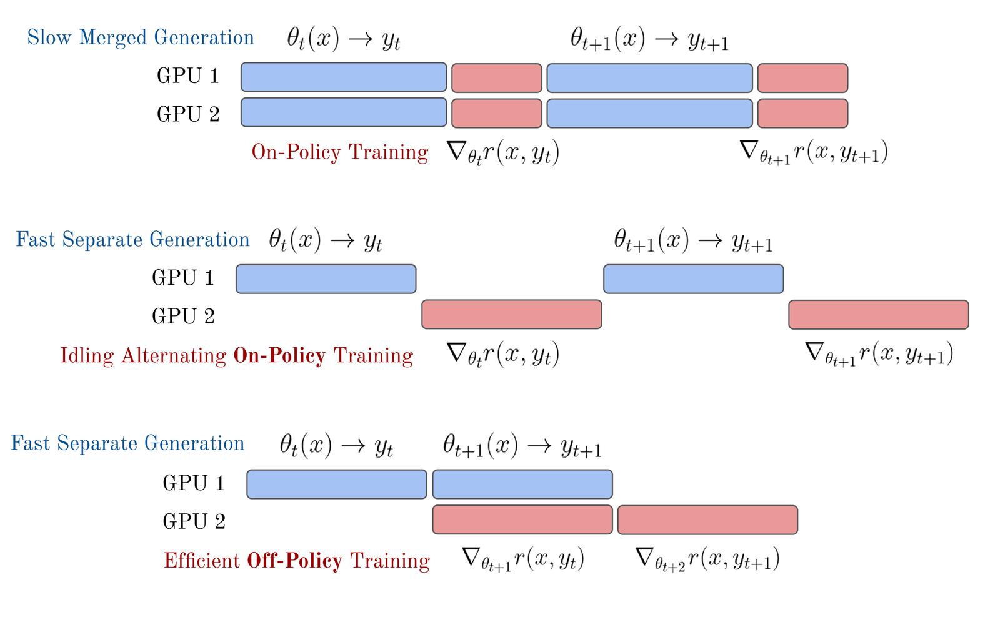
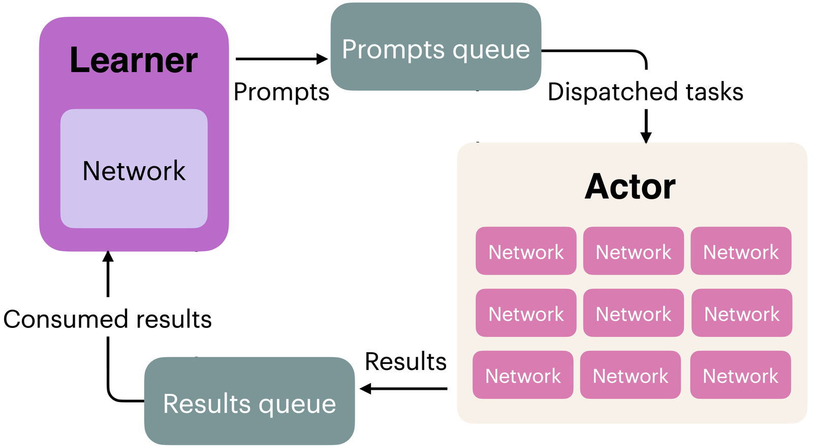

## 6.3 实现（Implementation）

相较于这些算法最初被发展出来的深度强化学习（Deep RL）文献，将 RL 用于优化语言模型或其他大型 AI 模型时，需要处理许多细小的实现细节。在本节中，我们会重点说明几个让各种流行算法的实现有所差异的关键因素。

这类训练还牵涉许多其他小细节。举例来说，对语言模型进行 RLHF 时，一个关键步骤是生成之后要交给奖励模型评分的文字。正常情况下，模型应该生成一个序列结束（end-of-sequence, EOS）token 来表示它已完成生成，但常见的做法是对生成长度设定硬性上限，以便有效利用基础设施。RLHF 的一种失败模式是模型的回答经常被截断，导致奖励模型的评分落到分布之外（out-of-distribution），产生无法预测的分数。解决之道是*只*在出现 `eos_token` 时才执行奖励模型评分，否则就对生成过长的模型施加惩罚。

流行的 RLHF 开源工具在各算法的实现细节上差异很大（见 [125] 中的表 10）。此处未涵盖的一些设计决策包括：

- **价值网络初始化（Value network initialization）**：PPO 与其他类似算法内部使用的学习型价值网络，可以从相同架构的另一个模型出发，也可以用随机权重初始化。这对性能可能有很大影响。InstructGPT [3] 建立的标准做法（Tülu 3 在其 RLVR 工作中再度沿用 [6]）是用 RLHF 期间使用的奖励模型来初始化价值网络。也有人使用 RLHF 训练之前的检查点（通常是 SFT 模型）并附加一个随机初始化的价值头（value head），或使用完全重新初始化的语言模型（较不常见，因为 RLHF 会需要更久才能收敛，但可行）。
- **奖励归一化、奖励白化与（或）优势白化（Reward normalization, reward whitening, and/or advantage whitening）**：归一化将 RM（或环境）给出的所有数值限制在 0 到 1 之间，有助于学习稳定性。白化（whitening）更进一步，把奖励或优势估计转换为零均值、单位方差，能提供更强的稳定性提升。
- **不同的 KL 估计器（Different KL estimators）**：面对复杂的语言模型，要精确计算模型之间的 KL 散度可能相当复杂，因此常以多种近似方法取代精确计算 [126]。
- **KL 控制器（KL controllers）**：PPO 及相关算法的原始实现具有动态控制器，会锁定特定的 KL 目标值，并根据近期的量测结果调整惩罚强度。大多数现代 RLHF 实现使用静态 KL 惩罚，但这一点同样可能有所不同。

关于 RLHF 实现细节的更多信息，请参阅 [127]。关于这些算法的进一步信息，请参阅 [128]。

### 6.3.1 策略梯度基础（Policy-Gradient Basics）

以下是一个简单的策略梯度实现，使用优势（advantage）来估计梯度，为 PPO 与 GRPO 等进阶算法做准备：

```python
pg_loss = -advantages * ratio
```

这里的 ratio 是新策略模型相对于参考模型的（逐 token）概率比值（通常由对数概率差计算而得）。

为了理解这个式子，最好先了解一批更新中可能出现的各种情况。请记住，我们希望随着模型在任务上表现越好，损失会*下降*。

情况 1：优势为正，表示该动作优于该状态的期望值。我们想要强化这个行为。在这种情况下，由于式中的负号，模型会让这个行为更有可能发生。为此，它会提高 logratio。正的 logratio，亦即 token 的对数概率总和变大，代表模型更有可能生成这些 token。

情况 2：优势为负，表示该动作劣于该状态的期望值。道理非常类似。此时，如果新模型让该序列变得更有可能，损失就会是正的，因此模型会设法调整策略参数，让这个补全（completion）变得更不可能。

情况 3：优势为零，因此不需要任何更新。损失为零，不要改变策略模型。

### 6.3.2 损失聚合的取舍（Loss Aggregation Tradeoffs）

以语言模型实现任何策略梯度算法时都会面临一个问题：如何把逐 token 的损失聚合成最终的标量损失？给定样本 $i$ 在 token $t$ 的逐 token 损失 $\ell_{i,t}$、补全长度 $|a_i|$ 与批次大小 $B$，主要有三种策略：

**策略 1：逐序列归一化（Per-sequence normalization）**（标准 GRPO；部分 PPO 实现也采用）

$$
L = \frac{1}{B}\sum_{i=1}^{B} \frac{1}{|a_i|}\sum_{t=1}^{|a_i|} \ell_{i,t} \tag{68}
$$

每个序列对批次损失的贡献相同，与长度无关。代码如下：

```python
# 策略 1：逐序列归一化
sequence_loss = ((per_token_loss * completion_mask).sum(dim=1) / \
            completion_mask.sum(dim=1)).mean()
```

**策略 2：逐 token 归一化（Per-token normalization）**（DAPO [129]）

$$
L = \frac{\sum_{i=1}^{B}\sum_{t=1}^{|a_i|} \ell_{i,t}}{\sum_{i=1}^{B} |a_i|} \tag{69}
$$

每个 token 的贡献相同；序列越长，对梯度的影响按比例越大。代码如下：

```python
# 策略 2：逐 token 归一化
token_loss = ((per_token_loss * completion_mask).sum() / \
            completion_mask.sum())
```

**策略 3：固定长度归一化（Fixed-length normalization）**（Dr. GRPO [118]）

$$
L = \frac{1}{B}\sum_{i=1}^{B} \frac{1}{L_{\max}}\sum_{t=1}^{|a_i|} \ell_{i,t} \tag{70}
$$

以最大序列长度 $L_{\max}$ 归一化，使各序列之间的逐 token 尺度一致，同时仍让较长的序列因为包含较多有效 token 而贡献较多的总梯度。代码如下：

```python
# 策略 3：固定长度归一化
fixed_len_loss = ((per_token_loss * completion_mask).sum(dim=1) / \
            L_max).mean()
```

其中 $L_{\max}$ 通常是整个训练流程期间的全域常数，用来指定生成 token 的最大数量。

请注意，上述代码中的 `completion_mask` 是一个由 1 和 0 组成的矩阵，其中提示（prompt）token 会被遮罩掉（设为 0），因为我们不希望模型从预测提示 token 中学习。

#### 6.3.2.1 为什么这很重要？（Why Does This Matter?）

直觉上，逐序列归一化（策略 1）似乎最好，因为我们在意的是*结果（outcomes）*，而不是个别 token。然而，这会引入基于序列长度的微妙偏误，依偏误方向不同，可能导致模型过度思考（overthink），或低估天生就需要使用较多 token 的策略。考虑两条长度不同、带有逐 token 损失的序列：

```python
seq_1_losses = [1, 1, 1, 1, 10]  # 5 个 token，平均 = 2.8
seq_2_losses = [1, 1, 1, 1, 1, 1, 1, 1, 1, 10]  # 10 个 token，平均 = 1.9
```

采用**策略 1**（逐序列）：批次损失为 $(2.8 + 1.9)/2 = 2.35$，而且关键在于，短序列中的每个 token 收到的梯度都比长序列中的 token 更大。

采用**策略 2**（逐 token）：批次损失为 $(14 + 19)/15 = 2.2$，所有 token 收到的梯度大小相同。

采用**策略 3**（固定长度，$L_{\max} = 10$）：短序列贡献 1.4，长序列贡献 1.9，在平衡逐 token 梯度的同时，仍以序列为单位加权。

想更完整地观察这些策略如何影响梯度，请参考下面的脚本。

```python
from typing import Optional
import torch

def masked_mean(values: torch.Tensor, mask: torch.Tensor, axis: Optional[int] = None) -> torch.Tensor:
    """计算带遮罩张量的平均值。"""
    if axis is not None:
        return (values * mask).sum(axis=axis) / mask.sum(axis=axis)
    else:
        return (values * mask).sum() / mask.sum()

def masked_sum(
        values: torch.Tensor,
        mask: torch.Tensor,
        axis: Optional[int] = None,
        constant_normalizer: float = 1.0,
    ) -> torch.Tensor:
    """计算带遮罩张量的总和。以常数进行归一化。"""
    if axis is not None:
        return (values * mask).sum(axis=axis) / constant_normalizer
    else:
        return (values * mask).sum() / constant_normalizer

ratio = torch.tensor([
    [1., 1, 1, 1, 1, 1, 1,],
    [1, 1, 1, 1, 1, 1, 1,],
], requires_grad=True)


advs = torch.tensor([
    [2, 2, 2, 2, 2, 2, 2,],
    [2, 2, 2, 2, 2, 2, 2,],
])

masks = torch.tensor([
    # 生成 1：4 个 token
    [1, 1, 1, 1, 0, 0, 0,],
    # 生成 2：7 个 token
    [1, 1, 1, 1, 1, 1, 1,],
])

max_gen_len = 7

masked_mean_result = masked_mean(ratio * advs, masks, axis=1)
masked_mean_token_level = masked_mean(ratio, masks, axis=None)
masked_sum_result = masked_sum(ratio * advs, masks, axis=1,
constant_normalizer=max_gen_len)

print("masked_mean", masked_mean_result)
print("masked_sum", masked_sum_result)
print("masked_mean_token_level", masked_mean_token_level)

# masked_mean tensor([2., 2.], grad_fn=<DivBackward0>)
# masked_sum tensor([1.1429, 2.0000], grad_fn=<DivBackward0>)
# masked_mean_token_level tensor(1., grad_fn=<DivBackward0>)

masked_mean_result.mean().backward()
print("ratio.grad", ratio.grad)
ratio.grad.zero_()
# ratio.grad tensor([[0.2500, 0.2500, 0.2500, 0.2500, 0.0000, 0.0000, 0.0000],
# [0.1429, 0.1429, 0.1429, 0.1429, 0.1429, 0.1429, 0.1429]])

masked_sum_result.mean().backward()
print("ratio.grad", ratio.grad)
ratio.grad.zero_()
# ratio.grad tensor([[0.1429, 0.1429, 0.1429, 0.1429, 0.0000, 0.0000, 0.0000],
# [0.1429, 0.1429, 0.1429, 0.1429, 0.1429, 0.1429, 0.1429]])

masked_mean_token_level.mean().backward()
print("ratio.grad", ratio.grad)
# ratio.grad tensor([[0.0909, 0.0909, 0.0909, 0.0909, 0.0000, 0.0000, 0.0000],
# [0.0909, 0.0909, 0.0909, 0.0909, 0.0909, 0.0909, 0.0909]])
```

输出显示，采用策略 1（`masked_mean`）时，短序列的逐 token 梯度（0.25）比长序列（0.14）更大。策略 2 与 3 则让各序列之间的逐 token 梯度相等。请注意，若使用梯度累积（gradient accumulation）——即在执行反向传播步骤之前，先将多个小批次（minibatch）的梯度加总——这些结果可能会大不相同；在这种情况下，较短与较长序列之间的平衡可能会反转。

实际应用中，最佳策略取决于特定的训练设定。在 RLHF 中，通常偏好数值稳定性最好、或损失变异最小的方法。

#### 6.3.2.2 相关议题：MDP 与拉霸机框架（Related: MDP vs. Bandit Framing）

损失聚合的选择，链接到我们如何框架化 RL 问题这个更深层的区别。**MDP（token 层级）**观点把每个 token $a_t$ 视为一个动作，状态 $s_t$ 则是当前的前缀。实际应用中，当我们以学习到的价值函数 $V(s_t)$ 计算 token 层级的优势（例如 GAE [112]）并逐 token 施加 KL 惩罚时，用的就是这种框架。搭配学习型价值网络的 PPO 是典型范例 [116]。

相对地，**拉霸机（bandit，序列层级）**观点把整个补全视为单一动作，对应一个标量奖励 $R$。在代码中，这代表计算一个序列层级的优势 $A_{\text{seq}}$，并将它广播到所有 token。RLOO 与 GRPO 式的优势常用于这种拉霸机式设定 [115] [111] [121]。DPO 与 A-LoL 等直接对齐方法也定义序列层级的目标，尽管它们并非策略梯度估计器 [130]。

请注意，许多 GRPO 实现使用拉霸机式优势，*同时*在损失中额外加入逐 token 的 KL 项；而许多 PPO/RLOO 实现则在计算优势之前，就把 KL 折入奖励之中；两种惯例在实际应用中都存在。

以下范例对比了这两种做法：

```python
# === 拉霸机式（序列层级） ===
# 每个序列一个标量奖励；优势广播到所有 token
reward = torch.tensor([3.0, 1.0])        # (B,) 例如奖励模型分数
baseline = reward.mean()                 # 简单基准线（RLOO 使用留一法）
advantage_seq = reward - baseline        # (B,)
advantages = advantage_seq[:, None].expand(-1, seq_len)  # (B, L)
# tensor([[ 1.,  1.,  1.,  1.],    <- 所有 token 的优势相同
#         [-1., -1., -1., -1.]])

# === MDP 式（token 层级） ===
# 逐 token 奖励 + 学习到的 V(s_t)；每个 token 有自己的优势
# （也可以使用逐 token 的 KL 塑形、格式奖励或其他 token 层级信号）
advantages = gae(per_token_rewards, values, done_mask, gamma=1.0, lam=0.95)
# tensor([[ 0.2,  0.5,  0.8,  1.5],   <- 随位置而异
#         [-0.3, -0.5, -0.8, -1.4]])
```

这种框架上的区别，也解释了为什么几乎所有 RLHF 实现都把折扣因子 $\gamma$ 设为 1.0。在标准 RL 中，折扣（$\gamma < 1$）是不可或缺的：它在多步回合（episode）中平衡短期与长期奖励的优化，这对智能体（agent）长期学到有效行为至关重要。但在 RLHF 设定中，即使采用 token 层级的 MDP 观点，优化的归纳偏置（inductive bias）仍是整体补全的质量——奖励信号评分的是整个回应，而非个别 token。对较早的 token 施加折扣，会在毫无原则性依据的情况下任意降低它们的贡献。随着代理式（agentic）RL 情境逐渐成熟——模型会采取工具调用、代码执行与网页浏览等真正的多步骤动作——折扣可能重新变得重要，因为这些情境涉及真正相异、且长期后果各不相同的循序决策。

### 6.3.3 异步 RL 系统（Asynchronous RL Systems）

策略梯度算法的默认实现是所谓的**同策略（on-policy）**执行：智能体（语言模型）采取的动作（生成内容）会先被评分，然后才更新模型。策略梯度的理论推导依赖所有动作都严格同策略，也就是模型永远掌握最新试验／rollout 的结果。实际应用中，维持严格的同策略执行会大幅拖慢训练 [131]——而且无论如何，完美的同步在技术上本来就不可能。因此，最近所有语言模型上的实证结果，其实都稍微超出理论证明的范围。实际应用中发生的事，是针对「实际行得通的做法」来设计算法与系统。


*图 23：依循 Noukhovitch 等人（2024）的做法，比较同步与异步 RL 训练中「生成—更新」阶段的示意图。*

常见的解法是让推论与训练持续在不同的 GPU 节点上执行，并使用专为高效同时运行两者而设计的软件，如图 23 底部所示。语言模型流行的开源 RL 工具的常见做法，是使用 Ray 之类的分布式行程管理函数库，在策略梯度学习循环与推论循环之间传递信息，而推论循环使用高效率的推论引擎，例如 vLLM。在这类架构中，负责执行 RL 步骤的 GPU 称为「learner（学习器）」，负责从语言模型抽样的 GPU 称为「actor（行动者）」。让训练更加异步时，面临的主要挑战是保持训练稳定并维持学习信号。

这些系统的设计与实现，都建立在「接近同策略的数据就足以稳定学习」这个前提之上。此时，生成与更新两个阶段可以轻松同步，避免训练系统的任一部分出现闲置运算，做法就是把模型权重从 learner 传递给图 24 中的 actor。对推理模型而言，问题本身的推论时间极长——每个答案需要 10K 到 100K+ 个 token——使得 rollout 的生成成为远更严重的瓶颈。在较同步的 RL 基础设施上训练推理模型时，一个常见的问题是批次中某一个提示的答案可能需要多得多的时间才能生成（无论是因为更多 token 还是更多次工具调用），导致大部分被分配的计算资源在它完成之前都处于闲置状态。针对这种长度不匹配问题的第二种解法称为序列层级打包（sequence-level packing）：透过巧妙的遮罩把较短的样本堆栈进同一批次，让模型能持续进行 rollout，并在批次内的样本之间更好地分配长度归一化。分布式 RL 基础设施的完整复杂度超出本书范围，因为它可能引发许多其他微妙的问题，拖慢训练或造成不稳定。


*图 24：一个分布式 RL 系统范例：透过管理两个队列，将数据传递给 learner 与 actor 的 GPU，两者可以用 Ray 等分布式计算函数库进行同步。Olmo Team 2025，授权 CC-BY。*

随着这些推理模型的兴起，人们进一步关注让训练与推论循环完全异策略（off-policy）化：策略梯度更新的训练批次，由多个实例生成答案时最近完成的 rollout 填满 [132] [133]。完全异步的训练还能让 RL 训练更容易横跨多个数据中心扩展，因为可以选择拉长 learner 节点（执行策略梯度步骤）与 actor（负责解题）之间权重同步的时间间隔 [134]。

相关方法也在探索完全异策略的策略梯度算法 [124]。

### 6.3.4 截断重要性抽样（Truncated Importance Sampling）

截断重要性抽样（Truncated Importance Sampling, TIS）是现代语言模型异步 RL 框架中，用来稳定训练的一项关键工具。重要性抽样（importance sampling）是一种校正手段，用来重新加权从某个分布抽出的样本，以估计另一个分布下的期望值（如第 (62) 式所介绍）。截断重要性抽样 [135] 以 $\min(\rho, C)$（$C$ 为某个常数）为这些权重设定上限，用少量偏差换取策略梯度中有界的方差。

这是施加在策略梯度上的重要性抽样校正，但与 PPO 和 CISPO 的双边裁剪（将比值约束在 1 附近）不同，TIS 使用单边上限：比值可以自由降到 1 以下，但会被截在 $C$，以防止极端的向上加权。在 PPO、GRPO、CISPO（及相关算法）中，比值 $\rho_t^{\text{policy}} = \pi_\theta(a_t \mid s)/\pi_{\theta_{\text{old}}}(a_t \mid s)$ 校正的是同一个 RL 批次内、多个梯度步之间的策略漂移（policy drift）。当我们转向以前一小节的异步性为核心概念的现实世界 RL 框架时，还可能出现更大的数值差异来源（同样需要重要性抽样的数值校正）。即使抽样器（sampler）与 learner 共用完全相同的参数 $\theta$，它们的有效 token 分布仍可能不同，因为推论引擎（例如 vLLM）与训练框架（例如 FSDP）使用不同的核心（kernel）、精度与平行化策略 [136]。因此，把同一个策略在两个系统上的评估结果加以区分是有用的，记为 $\pi_\theta^{\text{sampler}}$ 与 $\pi_\theta^{\text{learner}}$，并定义对应的比值及其截断形式：

$$
\rho_t^{\text{learner}} = \frac{\pi_\theta^{\text{learner}}(a_t \mid s, a_{<t})}{\pi_\theta^{\text{sampler}}(a_t \mid s, a_{<t})}, \qquad \bar{\rho}_t^{\text{learner}} = \min(\rho_t^{\text{learner}},\, C). \tag{71}
$$

这两种校正是互补的，但它们出现在策略梯度实现中的原因不同——一个补偿 RL 批次训练过程中的策略漂移，另一个补偿实现引起的分布差异——而且可以同时使用。两者如何结合，取决于算法：

#### 6.3.4.1 REINFORCE 搭配 TIS（单一梯度步）（REINFORCE with TIS (Single Gradient Step)）

这里不存在策略漂移（$\pi_\theta = \pi_{\theta_{\text{old}}}$），所以唯一的不匹配出现在 learner 与 sampler 之间。此时 $\pi_{\theta_{\text{old}}} = \pi_{\text{gen}}$，TIS 直接校正 learner–sampler 之间的差距：

$$
\nabla_\theta J \approx \mathbb{E}_{a \sim \pi_\theta^{\text{sampler}}} \left[ \bar{\rho}_t^{\text{learner}} \cdot A_t \cdot \nabla_\theta \log \pi_\theta^{\text{learner}}(a_t \mid s, a_{<t}) \right]. \tag{72}
$$

#### 6.3.4.2 PPO/GRPO 搭配 TIS（多个梯度步）（PPO/GRPO with TIS (Multiple Gradient Steps)）

现在两种比值同时起作用。在严谨的实现中，策略比值里的「旧 logprobs」会在 learner 上重新计算（GSPO 论文对此有讨论），因此策略比值 $\rho_t^{\text{policy}} = \pi_\theta^{\text{learner}}/\pi_{\theta_{\text{old}}}^{\text{learner}}$ 捕捉纯粹的策略漂移，而 $\bar{\rho}_t^{\text{learner}} = \min(\pi_{\theta_{\text{old}}}^{\text{learner}}/\pi_{\theta_{\text{old}}}^{\text{sampler}},\ C)$ 则另外校正生成检查点上的后端不匹配：

$$
J_{\text{PPO+TIS}}(\theta) = \mathbb{E}\left[ \min\!\left( \rho_t^{\text{policy}} A_t,\ \operatorname{clip}\!\left(\rho_t^{\text{policy}},\, 1-\varepsilon,\, 1+\varepsilon\right) A_t \right) \cdot \bar{\rho}_t^{\text{learner}} \right]. \tag{73}
$$

这里 $\pi_{\theta_{\text{old}}} \neq \pi_{\text{gen}}$：旧的 logprobs 来自 learner，而不是 sampler。如果某个框架跳过这个重新计算的步骤，直接把 sampler 的 logprobs 当作 $\pi_{\theta_{\text{old}}}$，那么策略比值本身就已经涵盖了后端不匹配，不需要额外的 TIS 校正——但此时裁剪操作作用在一个更嘈杂的比值上，这个比值甚至在任何梯度步之前就偏离了 1.0。这就是 Yao 等人 [136] 提出的「你的框架偷偷让你做了异策略 RL」（your framework secretly brings you off-policy RL）观察。

实际应用中，LLM 的 RL 系统会把 TIS 作为策略梯度损失上的逐 token 校正权重来使用：

```python
# 形状：(B*G, L)
C = 2.0  # TIS 上限

logratio = learner_logprobs - sampler_logprobs
logratio = logratio.clamp(-10.0, 10.0)               # 数值安全性
tis_weight = torch.exp(logratio).clamp(max=C)         # 单边截断

# 作为逐 token 策略梯度损失上的固定校正权重
per_token_pg_loss = per_token_pg_loss * tis_weight.detach()
```

这里的 $[-10, 10]$ clamp 只是取指数前的数值稳定性措施；真正的截断重要性抽样步骤是以 $C$ 为上限的单边截断。实际应用中，围绕这些 logprobs 的簿记工作——存储生成时的 sampler logprobs、在旧检查点上重新计算 learner logprobs、以及在梯度步中追踪当前 logprobs——是分布式 RL 框架中相当可观的一部分鹰架工程。与 GSPO 不同，这种校正是 token 层级的，因为它处理的是 token 层级的数值不匹配，而非序列层级的奖励粒度。针对 learner–sampler 比值的 TIS 已被各大开源 RL 框架采用（VeRL、TRL、OpenRLHF、SkyRL、OAT，以及使用 $C = 2$ 的 Open Instruct），而且对于长推理轨迹（第 7 章）越来越重要，因为微小的逐 token 差异会在数千个生成 token 之间不断累积。

### 6.3.5 范例：PPO（Example: PPO）

PPO 有非常多现成的实现。核心的*损失（loss）*计算如下所示。对稳定性能同样关键的还有*价值（value）*的计算，这部分存在多种选项（包括*价值模型*损失的多种选项）。

请注意，这里的参考策略（或旧的 logprobs）来自生成内容被抽样当下的时间点，不一定是参考策略。参考策略只用于 KL 距离约束／惩罚。

```python
# B：批次大小，L：序列长度，G：生成数量
# 将 KL 惩罚施加到奖励上
rewards = rewards - self.beta * per_token_kl  # 形状：(B*G, L)

# 取得价值预测
values = value_net(completions)  # 形状：(B*G, L)

# 以反向循环计算回报（LM RLHF 的 gamma 通常为 1.0）
# 对奖励做遮罩，避免填充 token（可能带有 KL 惩罚）泄漏进回报
returns = torch.zeros_like(rewards)
running = torch.zeros(rewards.shape[0], device=rewards.device, dtype=rewards.dtype)
for t in reversed(range(rewards.shape[1])):
    # 将填充归零：只对有效的补全 token 累积奖励／回报
    running = (rewards[:, t] + self.gamma * running) * completion_mask[:, t]
    returns[:, t] = running

# 计算优势：A_t = G_t - V(s_t)
advantages = returns - values.detach()  # 形状：(B*G, L)
# 注意：这里对价值网络做 detach，以免在计算策略梯度损失时
# 更新价值函数的参数

# 归一化优势（非必要但较稳定）
advantages = (advantages - advantages.mean()) / (advantages.std() + 1e-8)
```

```python
# 计算新旧策略之间的概率比值
ratio = torch.exp(new_per_token_logps - per_token_logps)  # 形状：(B*G, L)

# PPO 裁剪目标
eps = self.cliprange  # 例如 0.2
pg_losses1 = -advantages * ratio  # 形状：(B*G, L)
pg_losses2 = -advantages * torch.clamp(ratio, 1.0 - eps, 1.0 + eps)  # 形状：(B*G, L)
pg_loss_max = torch.max(pg_losses1, pg_losses2)  # 形状：(B*G, L)

# 价值函数损失：预测回报
vf_loss = 0.5 * ((returns - values) ** 2)  # 形状：(B*G, L)

# 结合策略与价值损失
per_token_loss = pg_loss_max + self.vf_coef * vf_loss  # 形状：(B*G, L)

# 套用补全遮罩并计算最终损失
loss = ((per_token_loss * completion_mask).sum(dim=1) /
completion_mask.sum(dim=1)).mean()
 # 标量

# 计算用于记录的指标
with torch.no_grad():
    # 计算裁剪比例
    clip_frac = ((pg_losses2 > pg_losses1).float() * completion_mask).sum() / \
completion_mask.sum()

    # 计算近似 KL
    approx_kl = (0.5 * ((new_per_token_logps - per_token_logps)**2) * \
completion_mask).sum() / completion_mask.sum()

    # 计算用于记录的价值损失
    value_loss = vf_loss.mean()
```

理解 PPO 的核心，在于策略梯度损失如何更新。请聚焦在这三行：

```python
pg_losses1 = -advantages * ratio  # 形状：(B*G, L)
pg_losses2 = -advantages * torch.clamp(ratio, 1.0 - eps, 1.0 + eps)  # 形状：(B*G, L)
pg_loss_max = torch.max(pg_losses1, pg_losses2)  # 形状：(B*G, L)
```

`pg_losses1` 是普通的、以优势加权的策略梯度损失。`pg_losses2` 套用相同的公式，但把概率比值钳制在 $[1-\varepsilon, 1+\varepsilon]$ 范围内，限制策略在单次更新中能改变的幅度。

关键洞见在于对两个损失取 `torch.max`。因为我们最小化的是一个*负的*损失（回想优势前面的负号），取最大值会选出更悲观的梯度——即产生较小策略更新的那一个。当优势为正（好的动作）时，裁剪防止策略过于激进地提高该动作的概率；当优势为负（坏的动作）时，裁剪防止朝反方向的过度修正。

透过钳制对数概率比值，PPO 限制了策略偏离「生成训练数据的那个版本」的距离，在不需要显式信赖域（trust region）计算的情况下稳定学习。

上面的代码也显示 PPO 在策略之外同时学习一个价值函数，这增加了实现复杂度，但裁剪后的目标才是核心机制。

#### 6.3.5.1 每个样本一个梯度步时的 PPO/GRPO 简化（无裁剪）（PPO/GRPO Simplification with One Gradient Step per Sample (No Clipping)）

若超参数「每个样本的梯度步数」等于 1，PPO（与 GRPO）的实现可以优雅得多。这个值的典型设定通常是 2–4 或更高。在 PPO 或 GRPO 的主要公式中（见第 (51) 式），「参考」策略是先前的参数——也就是生成补全或动作时所用的那组参数。因此，若只取一个梯度步，则 $\pi_\theta = \pi_{\theta_{\text{old}}}$，更新规则简化如下（记号 $[\,]_\nabla$ 表示停止梯度，stop gradient）：

$$
J(\theta) = \frac{1}{G}\sum_{i=1}^{G} \left( \frac{\pi_\theta(a_i|s)}{\left[\pi_\theta(a_i|s)\right]_\nabla} A_i - \beta \mathcal{D}_{\mathrm{KL}}(\pi_\theta || \pi_{\text{ref}}) \right). \tag{74}
$$

这使得 PPO 或 GRPO 的实现可以省略第二个策略梯度与裁剪逻辑，让优化器远远更接近标准的策略梯度。

### 6.3.6 范例：GRPO（Example: GRPO）

DeepSeekMath 论文描述了 GRPO 一些与 PPO 不同的实现细节 [121]，尤其是与深度强化学习（而非语言模型）中 PPO 的标准用法相比。例如，RLHF 优化中的 KL 惩罚（回想一下，在没有奖励模型、以可验证奖励训练推理模型时，也会使用 KL 惩罚）是直接施加在损失更新中，而不是施加在奖励函数上。标准 RLHF 的 KL 惩罚施加方式为 $r = r_\theta - \beta \mathcal{D}_{\mathrm{KL}}$，而 GRPO 的实现大致是：

$$
L = L_{\text{policy gradient}} + \beta * \mathcal{D}_{\mathrm{KL}} \tag{75}
$$

不过，实现方式有很多种。传统上，KL 距离是针对提示 $s$ 的补全中的每一个 token 计算的。在推理训练中，会从一个提示抽样多个补全，而一个批次中有多个提示，所以 KL 距离的形状会是 [B, L, N]，其中 B 是批次大小，L 是序列长度，N 是每个提示的补全数量。

综合起来，使用第一种损失聚合方式，伪代码可以写成如下。

```python
# B：批次大小，L：序列长度，G：生成数量
# 计算逐群组奖励 # 形状：(B,)
mean_grouped_rewards = rewards.view(-1, self.num_generations).mean(dim=1)
std_grouped_rewards = rewards.view(-1, self.num_generations).std(dim=1)


# 对奖励做归一化以计算优势
mean_grouped_rewards = mean_grouped_rewards.repeat_interleave(self.num_generations, dim=0)
std_grouped_rewards = std_grouped_rewards.repeat_interleave(self.num_generations, dim=0)
# 形状：(B*G,)

# 计算优势
advantages = (rewards - mean_grouped_rewards) / (std_grouped_rewards + 1e-4)
advantages = advantages.unsqueeze(1)
# 形状：(B*G, 1)

# 计算新旧策略之间的概率比值
ratio = torch.exp(new_per_token_logps - per_token_logps)  # 形状：(B*G, L)

# PPO 裁剪目标
eps = self.cliprange  # 例如 0.2
pg_losses1 = -advantages * ratio  # 形状：(B*G, L)
pg_losses2 = -advantages * torch.clamp(ratio, 1.0 - eps, 1.0 + eps)  # 形状：(B*G, L)
pg_loss_max = torch.max(pg_losses1, pg_losses2)  # 形状：(B*G, L)

# GRPO 的重点——PPO 传统上将此施加在奖励中
# 与 KL 惩罚结合
per_token_loss = pg_loss_max + self.beta * per_token_kl  # 形状：(B*G, L)

# 套用补全遮罩并计算最终损失
loss = ((per_token_loss * completion_mask).sum(dim=1) /
completion_mask.sum(dim=1)).mean()
 # 标量

# 计算用于记录的核心指标（KL、奖励等也会记录）
with torch.no_grad():
    # 计算裁剪比例
    clip_frac = ((pg_losses2 > pg_losses1).float() * completion_mask).sum() / \
completion_mask.sum()

    # 计算近似 KL
    approx_kl = (0.5 * ((new_per_token_logps - per_token_logps)**2) * \
completion_mask).sum() / completion_mask.sum()
```

关于如何解读这段代码的更多细节，请参阅上面的 PPO 一节。与 PPO 范例的核心差异如下：

- **优势计算（Advantage computation）**：GRPO 以群组为基准归一化奖励（对同一提示的多个生成取平均值与标准差），而不是使用学习到的价值函数作为基准线。
- **没有价值网络（No value network）**：GRPO 完全移除价值模型，省去 `vf_loss` 及其相关复杂度。
- **KL 惩罚的位置（KL penalty placement）**：GRPO 把 KL 惩罚直接加进损失，而不是从奖励中扣除（这是标准实现，但 KL 的施加方式还存在更多版本）。

#### 6.3.6.1 RLOO 与 GRPO（RLOO vs. GRPO）

RLOO 的优势更新和 GRPO 非常接近，凸显出这两个算法在概念上的相似性——只要把 PPO 式的裁剪与 KL 惩罚细节分开来看。具体来说，RLOO 的优势是相对于一个与 GRPO 极为相似的基准线计算的——即该补全的奖励相对于同一问题其他补全的奖励。简明地说，RLOO 的优势估计如下（扩充自 TRL 的实现）：

```python
# rloo_k --> 每个提示的补全数量
# rlhf_reward --> 起初是所有补全总奖励的平坦张量。长度 B = N x k
rlhf_reward = rlhf_reward.reshape(rloo_k, -1) #
# 现在形状为：(k, N)，每一栏 j 包含提示 j 的 k 个奖励。

baseline = (rlhf_reward.sum(0) - rlhf_reward) / (rloo_k - 1)
# baseline --> 留一法（leave-one-out）基准线奖励。形状：(k, N)
#  baseline[i, j] 是提示 j 上所有 i' != i 样本的平均奖励。

advantages = rlhf_reward - baseline
# advantages --> 相同形状：(k, N)

advantages = advantages.flatten() # 与原始张量形状相同
```

RLOO 其余的实现细节，同样遵循实现策略梯度时的其他取舍。

## 6.4 辅助主题（Auxiliary Topics）

要精通策略梯度算法的应用，还有无数其他考量。此处我们讨论成功部署策略梯度 RL 算法时，一些位于长尾的复杂细节。

### 6.4.1 广义优势估计（Generalized Advantage Estimation, GAE）

广义优势估计（Generalized Advantage Estimation, GAE）是策略梯度算法计算优势的另一种方法 [112]，能更好地平衡偏差与方差之间的权衡。传统的单步优势估计可能引入过多偏差，而使用完整轨迹则常有高方差的问题。GAE 计算多步优势估计的指数加权平均，其中超参数 $\lambda$ 控制偏差–方差的权衡——范围从单步 TD（$\lambda = 0$）到完整轨迹回报（$\lambda = 1$）；$\lambda = 0.95$ 是 LLM 微调的常见默认值。

优势估计可以有多种形式，我们可以定义一个 $n$ 步优势估计器（类似本章开头的 TD 残差）如下：

$$
\hat{A}_t^{(n)} = \begin{cases} r_t + \gamma V(s_{t+1}) - V(s_t), & n = 1 \\ r_t + \gamma r_{t+1} + \gamma^2 V(s_{t+2}) - V(s_t), & n = 2 \\ \vdots & \\ r_t + \gamma r_{t+1} + \gamma^2 r_{t+2} + \cdots - V(s_t), & n = \infty \end{cases} \tag{76}
$$

这里 $n$ 越短，方差越低但偏差越高，因为我们把更多的学习能力归于每一条轨迹——它可能会过拟合。GAE 试图把这个公式推广为一个加权的多步平均，而不是选定某个特定的 $n$。首先，我们必须定义预测价值的时序差分（temporal difference, TD）残差：

$$
\delta_t^V = r_t + \gamma V(s_{t+1}) - V(s_t) \tag{77}
$$

为了利用它，我们引入另一个变量 $\lambda$ 作为 GAE 的混合参数。它会折成我们想要估计的未来优势的指数衰减：

$$
\begin{aligned}
\hat{A}_t^{GAE(\gamma,\lambda)} &= (1-\lambda)(\hat{A}_t^{(1)} + \lambda \hat{A}_t^{(2)} + \lambda^2 \hat{A}_t^{(3)} + \cdots) \\
&= (1-\lambda)(\delta_t^V + \lambda(\delta_t^V + \gamma\delta_{t+1}^V) + \lambda^2(\delta_t^V + \gamma\delta_{t+1}^V + \gamma^2\delta_{t+2}^V) + \cdots) \\
&= (1-\lambda)(\delta_t^V(1 + \lambda + \lambda^2 + \cdots) + \gamma\delta_{t+1}^V(\lambda + \lambda^2 + \cdots) + \cdots) \\
&= (1-\lambda)\left(\delta_t^V \frac{1}{1-\lambda} + \gamma\delta_{t+1}^V \frac{\lambda}{1-\lambda} + \cdots\right) \\
&= \sum_{l=0}^{\infty}(\gamma\lambda)^l \delta_{t+l}^V
\end{aligned} \tag{78}
$$

直觉上，这可以用来以优雅的方式平均多步的优势估计。范例实现如下：

```python
# LM RLHF 的 GAE（token 层级）
#
# B：批次大小
# L：长度
# 输入：
#   rewards：  (B, L) 施加 KL 之后的逐 token 奖励
#   values：   (B, L) 当前的 V_theta(s_t)
#   done_mask：(B, L) 终止 token（EOS 或被惩罚的截断）处为 1.0，其余为 0.0
#   gamma：float（通常为 1.0），
#   lam（lambda 的缩写）：float，位于 [0,1]
#   （终止之后的填充应设 rewards=0、values=0）
B, L = rewards.shape
advantages = torch.zeros_like(rewards)
next_v = torch.zeros(B, device=rewards.device, dtype=rewards.dtype)
gae = torch.zeros(B, device=rewards.device, dtype=rewards.dtype)

for t in reversed(range(L)):
    not_done = 1.0 - done_mask[:, t]
    delta = rewards[:, t] + gamma * not_done * next_v - values[:, t]
    gae = delta + gamma * lam * not_done * gae
    advantages[:, t] = gae
    next_v = values[:, t]

targets = advantages + values      # 价值回归的 y_t
advantages = advantages.detach()   # 用于策略损失
```

这个反向循环累积时序差分（TD）误差（$\delta_t = r_t + \gamma V(s_{t+1}) - V(s_t)$），它衡量实际结果比价值函数的预测好或坏多少，并以 $(\gamma\lambda)^l$ 进行指数衰减。在终止 token 处，`not_done=0` 防止从后续状态进行自举（bootstrapping）并重设 GAE 累积器，因此每个回合的优势是各自独立计算的（由于循环是反向执行的，终止 token 会在回合边界干净地截断指数加权的累积——这使得这个实现对打包（packing）友善，能正确处理串接成一条的多个序列）。最终的 `targets` 作为另外训练的价值函数（在这个 GAE 循环之外学习）的回归目标，而 detach 后的 `advantages` 用来加权策略梯度——之所以 detach，是为了让策略更新不会把梯度反向传播进价值网络。在语言模型的 RLHF 中，$\gamma = 1.0$ 很常见，因为回合是短的 token 序列，偏好无折扣的信用分配（credit assignment）（而且往往是所有 token 一起）。

*延伸阅读请见 [137]。*

### 6.4.2 双重正则化（Double Regularization）

本章我们已看过两种正则化。一种以步长约束的形式内置在 PPO 这类算法中，另一种则是相对于优化起点的、基于 KL 散度的距离惩罚。

深度强化学习中许多流行的策略梯度算法（包括 PPO 及其前身）的诞生，都源自于控制智能体学习过程的需求。在 RLHF 中——如第 15 章「正则化」与第 3 章「训练总览」所深入讨论的——本身就内置了一个正则化项，即相对于被微调的原始策略的距离惩罚。从这个观点来看，PPO（具有内部步长正则化）与 REINFORCE（更简单，且在特定超参数下 PPO 会退化为它）这类算法之间的差异，对于微调语言模型来说，远不如从零开始训练智能体时那么重要。

在 PPO 中，负责限制更新步长上限的目标称为代理目标（surrogate objective）。要监控 PPO 的正则化对 RLHF 更新的影响程度，可以观察许多流行实现中的 clip fraction 变量，也就是批次中概率比值落在裁剪区间之外的样本百分比。这是 PPO 正则器可能生效频率的有用代理指标，但并非每个这样的样本梯度都为零：只有在选中被裁剪的分支时，代理目标才会变平——例如比值高于 $1+\varepsilon$ 的正优势样本，或比值低于 $1-\varepsilon$ 的负优势样本。

在语言模型的实际应用中，PPO 与 GRPO 这类算法通常每批次只执行一个梯度步，这意味着 PPO 原生的正则化从未生效（因为裁剪只可能在策略于批次内大幅改变时发生），而 KL 距离惩罚占主导地位。不过这并非通则。例如，DAPO 每批次使用 16 个梯度步 [129]，而 Tülu 3 对 8B 与 70B 模型每批次使用 4 次 PPO 更新迭代，但对 405B 模型降为 1 次以维持训练稳定性 [6]。

### 6.4.3 延伸阅读（Further Reading）

随着 RLHF 巩固了它在现代后训练（post-training）核心的地位，人们陆续提出其他策略梯度 RL 算法以及一般性的 RL 算法来改进训练流程，但它们尚未在主导最佳实践方面扮演核心角色。延伸阅读的例子包括：

- **成对近端策略优化（Pairwise Proximal Policy Optimization, P3O；Wu 等人，2023）** [138]：直接在 PPO 式的策略更新中使用成对数据，无需学习中介的奖励模型。
- **软性自适应策略优化（Soft Adaptive Policy Optimization, SAPO）** [139]：以平滑、由温度控制的闸控（gating）取代 PPO/GRPO 式的硬裁剪，目标是建立连续的信赖域，在降低异策略 token 权重的同时，保留接近同策略的学习信号。
- 异策略的策略梯度算法可以实现更进一步的异步训练，例如**对比策略梯度（Contrastive Policy Gradient, CoPG）** [140]（直接对齐算法 IPO 与普通策略梯度的推广），Cohere 曾将其用于其 Command A 模型 [57]。
- 也有其他为语言模型设计的 REINFORCE 算法实现，例如 **ReMax** [141]，它实现了一种专门为了因应奖励模型推论的不确定性来源而设计的基准线归一化。
- 部分基础模型，例如 Apple Intelligence Foundation Models [142] 或 Kimi k1.5 推理模型 [143]，使用了**镜像下降策略优化（Mirror Descent Policy Optimization, MDPO）** [144] 的变体。这方面的基础研究仍在持续发展中 [145]，但 Mirror Descent 是一种优化方法，而不直接是一种策略梯度算法。这里的重点在于，它能以与既有 RL 基础设施非常相似的方式替换使用。
- **解耦裁剪与动态抽样策略优化（Decoupled Clip and Dynamic sAmpling Policy Optimization, DAPO）**：针对推理语言模型提出对 GRPO 的 4 项修改，以更适应需要长轨迹、且需要提高新的、未被充分利用的 token 概率的场景 [129]。这些修改是：1、使用两个不同的裁剪超参数 $\varepsilon_{\text{low}}$ 与 $\varepsilon_{\text{high}}$，让 logratio 正侧的裁剪可以踏出更大的步伐以利探索；2、动态抽样，移除批次中所有奖励全为 0 或全为 1 的样本（没有学习信号）；3、使用前文「实现：GRPO」中讨论的逐 token 损失；以及 4、对过长的样本施加软性惩罚，以避免从被截断的答案中学习。
- **基于价值的增强近端策略优化（Value-based Augmented Proximal Policy Optimization, VAPO）** [146]：结合 DAPO 的多项优化（包括更高的裁剪上限、token 层级策略梯度与不同的长度归一化）与 Value-Calibrated PPO [147] 的洞见，预先训练价值函数并使用长度自适应的 GAE，展示了基于价值的方法相对于 GRPO 的潜力。

## 6.5 建议实验（Suggested Experiments）

随附的实现代码位于 `code/policy_gradients/`，是为小型、可观察的 RL 训练而设计。默认设定档会在来自 `reasoning-gym` 的 `spell_backward` 程序性任务上训练 `Qwen/Qwen3-1.7B`；这是很好的第一个练习，因为失败与部分进展都很容易查看。

1. **用 GRPO 执行单字反转任务。**

   ```bash
   cd code/
   uv run python -m policy_gradients.train --config policy_gradients/configs/grpo.yaml
   ```

   追踪 `avg_correctness`、`avg_format` 与 `avg_binary`。第一个值得问的问题是每个提示群组是否包含对比：如果抽样出的补全全对或全错，群组相对（group-relative）更新几乎没有学习信号。

2. **比较群组相对与单一样本估计器。** 执行对应的起始设定档：

   ```bash
   cd code/
   uv run python -m policy_gradients.train --config policy_gradients/configs/reinforce.yaml
   uv run python -m policy_gradients.train --config policy_gradients/configs/rloo.yaml
   uv run python -m policy_gradients.train --config policy_gradients/configs/grpo.yaml
   ```

   比较正确性信号改善的速度，以及损失的噪声程度。相较于只看公式，RLOO 与 GRPO 应该能让提示内基准线（within-prompt baseline）的角色具体得多。

3. **扫描对比旋钮。** 复制 `policy_gradients/configs/grpo.yaml`，并改变 `num_rollouts`、`temperature`、`data.size` 与 `format_weight`。较小的 `num_rollouts` 会降低群组对比；温度太低可能使样本塌缩（collapse）；温度太高则会产生太多格式错误的答案。这是理解为什么 RLVR 配方常在动优化器之前，先在抽样设定上投入大量心力的最简单方式。

4. **从玩具奖励迈向数学。** 对于 GSM8K 式的实验，先从 `code/reward_models/train_orm.py` 与 `code/rejection_sampling/` 的范例着手，再添加新的在线 RL 环境。一个不错的贡献方向是：一个小型的 `reasoning-gym` 或 GSM8K 策略梯度设定档，能在 sub-1B 的 Qwen 模型上执行，并回报相同的群组对比诊断指标。
